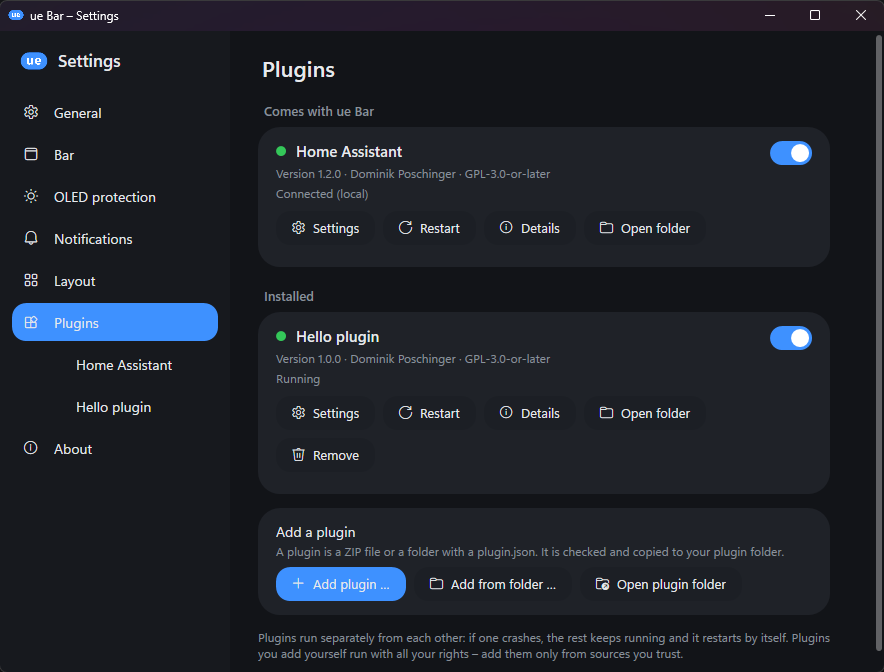

# ue Bar

[English](README.md) · **Deutsch**

Ein ausfahrbares Dashboard am oberen Bildschirmrand von Windows. Maus an den oberen Rand: Eine
kleine Pill erscheint und mit ihr deine Kacheln, eine Statuszeile, Benachrichtigungen und eine
Schnellsuche. Vorbild ist die „Now Bar“ von Samsung One UI. Was die Kacheln zeigen, kommt aus
**Plugins** – [Home Assistant](plugins/HomeAssistant/README.de.md), [Windows](plugins/Windows/README.de.md)
(Lautstärke, Medien, WLAN, Bluetooth, Akkus, Systemwerte dieses PCs), [Timer](plugins/Timer/README.de.md)
(Timer, Stoppuhr, Pomodoro), [Schnellzugriff](plugins/QuickAccess/README.de.md) (Apps, Dateien,
Ordner, Webseiten als Kacheln) und [Screenshot](plugins/Screenshot/README.de.md) (aufnehmen, anpinnen,
Text erkennen) werden mitgeliefert; weitere kommen dazu, ohne die App neu zu bauen. Notizen und
Screenshots lassen sich als kleine Fenster, die immer obenauf bleiben, auf dem Bildschirm **anpinnen**.


| Pill | Bearbeiten | Einstellungen → Plugins |
|---|---|---|
|  |  |  |

## Was die Bar kann

- **Pill und Panel am oberen Rand**: erscheint nach kurzem Verweilen, bleibt offen, solange die
  Maus darauf ist, oder lässt sich fixieren. Mehrere Monitore, bei Vollbild-Apps ausgeblendet.
- **Kacheln in Tabs**, live aktualisiert. **Bearbeiten-Modus** direkt im Panel: Kacheln per Suche
  hinzufügen, Größe ändern, verschieben (auch in andere Tabs), Tabs pro Gerät oder für alle, Tabs
  nur daheim oder nur unterwegs.
- **Statuszeile** mit kleinen Werten im Panel und in der Pill, **Now Playing** in der Pill.
- **Benachrichtigungen** im Panel, mit Verlauf.
- **Schnellsuche** mit globalem Tastenkürzel (Standard `Win + Alt + Leertaste`).
- **Pins**: Notizen und Screenshots als kleine Fenster über allem (siehe unten).
- **Deutsch und Englisch**, im laufenden Betrieb umschaltbar. Zahlen und Uhrzeiten nach der
  Windows-Region.
- OLED-Schutz (Abdunkeln, Pixel-Shift), eingeklappt sparsam mit Ressourcen.

## Pins

Ein Pin ist ein kleines Fenster, das über allem bleibt – eine Notiz oder ein Screenshot zum
Abschreiben, während du in einem anderen Fenster arbeitest.

- **Anlegen:** `pin <Text>` in der Schnellsuche oder im Assist, **Notiz anpinnen** in der Pin-Liste der
  Bar (Pin-Symbol im Panel), ein Screenshot ([Screenshot-Plugin](plugins/Screenshot/README.de.md),
  `Win + Alt + S`) – und jedes Plugin über das SDK.
- **Bedienen:** ziehen = verschieben (rastet an den Bildschirmrändern ein), am Rand ziehen = Größe.
  Bilder: Mausrad = Zoom, gezoomtes Bild ziehen = verschieben, Doppelklick = einpassen. Text:
  Doppelklick = bearbeiten, `Strg` + Mausrad = Schriftgröße.
- **Rechtsklick:** Kopieren · Speichern unter (Bild) · Deckkraft · Position sperren · **Klicks
  durchlassen** (der Pin bleibt sichtbar, du arbeitest „durch ihn hindurch“) · Ausblenden · Schließen.
- **Alle auf einmal:** `Win + Alt + P` blendet alle Pins aus oder ein (änderbar unter
  **Einstellungen → Pins**); beim Einblenden werden durchlässige Pins wieder anklickbar. Die
  Pin-Liste in der Bar zeigt, versteckt und schließt einzelne oder alle.
- **OLED-freundlich:** Nach 60 s ohne Maus wird ein Pin auf 35 % abgedunkelt und ist sofort wieder
  hell, wenn die Maus kommt; alle Pins wandern alle paar Minuten um ein, zwei Pixel; über Vollbild-Apps
  sind sie ausgeblendet. Alles unter **Einstellungen → Pins** einstellbar.
- Pins überstehen einen Neustart (Inhalt, Größe, Platz – pro Monitor; fehlt der Monitor, kommt der
  Pin auf den Hauptbildschirm). Sie liegen nur auf diesem PC (`%APPDATA%\ueBar\pins`), nie im
  synchronisierten Layout.


## Voraussetzungen

- Windows 10 (ab Version 1809) oder Windows 11, x64
- .NET 10 Desktop Runtime – der Installer lädt sie bei Bedarf von Microsoft; die portable
  Version braucht sie nicht
- Was ein Plugin braucht, steht in seiner README (Home Assistant: eine vom PC erreichbare Instanz
  und ein langlebiges Zugriffstoken; Windows: nichts, ab Windows 10 2004)

## Installation

Herunterladen auf der Seite [Releases](../../releases):

- `ueBar-Setup-<version>.exe` – Installer (Deutsch/Englisch, ohne Administratorrechte, nach
  `%LOCALAPPDATA%\Programs\ueBar`)
- `ueBar-<version>-portable.exe` – eine einzelne Datei, nichts zu installieren
- für Plugin-Autoren: `UeBar.Sdk.<version>.nupkg` (das SDK) und `ueBar-plugin-<id>-<version>.zip`
  (Plugins, die nicht mitgeliefert werden, z. B. das Beispiel-Plugin)

**Windows SmartScreen:** Die Dateien sind nicht signiert, deshalb zeigt Windows eventuell „Der
Computer wurde durch Windows geschützt“. Klicke auf **Weitere Informationen → Trotzdem
ausführen**. Im Zweifel selbst aus dem Quellcode bauen (siehe unten).

Einstellungen, Layout und Logs liegen in `%APPDATA%\ueBar`.

## Erste Schritte

1. ue Bar starten. Beim ersten Start richtet ein Willkommens-Assistent das mitgelieferte Plugin
   ein – bei Home Assistant: Adresse und Token, dann die Bereiche, die in die Bar sollen
   ([Details](plugins/HomeAssistant/README.de.md#erste-einrichtung)).
2. Maus an den oberen Bildschirmrand: Die Pill erscheint; bleibst du darauf, öffnet sich das
   Panel. Mit der Nadel bleibt es offen.
3. Der Stift startet den Bearbeiten-Modus, das Zahnrad (oder ein Doppelklick auf das
   Tray-Symbol) öffnet die Einstellungen.

## Plugins

Jede Quelle von Kacheln ist ein Plugin: ein Ordner mit `plugin.json` und seinen DLLs, der beim
Start geladen wird, jedes in einem eigenen Ladekontext. Ein kaputtes oder nicht passendes Plugin
steht mit Grund unter **Einstellungen → Plugins** – die App läuft weiter, seine Kacheln zeigen
einen Platzhalter. Mitgelieferte Plugins werden gegen eine beim Bau erzeugte Prüfsummenliste
geprüft und laden ohne Nachfrage. Bei jedem anderen fragt ue Bar einmal (Name, Autor, Version,
Quelle und eine deutliche Warnung) und wieder, wenn sich seine Dateien ändern. Hinzufügen als ZIP
über **Einstellungen → Plugins → Plugin hinzufügen …**.

| Plugin | Was es macht | Mitgeliefert |
|---|---|---|
| [Home Assistant](plugins/HomeAssistant/README.de.md) | Lichter, Klima, Medien, Staubsauger, Sensoren u. v. m. aus Home Assistant; Benachrichtigungen, Assist, Layout-Sync | ja |
| [Windows](plugins/Windows/README.de.md) | Dieser PC: Lautstärke und Ausgabegerät, App-Lautstärke, Medien aller Apps (auch als Now Playing), WLAN, Bluetooth, Geräte-Akkus, Akku, CPU, Arbeitsspeicher, Datenträger, Helligkeit, Sperren/Energiesparen | ja |
| [Timer](plugins/Timer/README.de.md) | Timer mit Voreinstellungen und Namen, Stoppuhr, Pomodoro (kann Aktionen anderer Plugins auslösen); `t 10` in der Schnellsuche, Restzeit in der Pill | ja |
| [Schnellzugriff](plugins/QuickAccess/README.de.md) | Startmenü-Apps, Dateien, Office-Vorlagen (neues Dokument), Ordner, Webseiten und eigene Befehle als Kacheln mit echten Symbolen – auch bis zu sechs in einer Kachel; Ziehen und Ablegen, Schnellsuche | ja |
| [Screenshot](plugins/Screenshot/README.de.md) | Bereich, Fenster oder Bildschirm aufnehmen (`Win + Alt + S`), dann anpinnen, kopieren, speichern oder Text erkennen (Windows-OCR, offline) | ja |
| [Test-Modul](plugins/Dummy/README.de.md) | Simulierte Geräte zum Entwickeln und Testen von ue Bar | nein – Debug-Builds und eigenes ZIP |
| [Hallo](samples/HelloPlugin) | Beispiel-Plugin: eine Zähler-Kachel, Ausgangspunkt für eigene | nein – Beispiel im Quellcode |

### Plugins von anderen

Noch keine. Selbst eins schreiben? Los geht’s mit [Plugin schreiben](docs/WRITING-A-PLUGIN.md)
(Englisch) – Plugins liegen in einem eigenen Repository und brauchen nur das SDK-Paket.

## Aus dem Quellcode bauen

Voraussetzung: [.NET 10 SDK](https://dotnet.microsoft.com/download/dotnet/10.0) unter Windows.

```powershell
dotnet build
dotnet test
dotnet run --project src/UeBar.App
```

Installer, portable Exe, SDK-Paket und Plugin-ZIPs (braucht
[Inno Setup 6](https://jrsoftware.org/isinfo.php)):

```powershell
powershell -ExecutionPolicy Bypass -File build/publish.ps1
```

Die Ergebnisse landen in `dist/`. Zum Entwickeln die Umgebungsvariable `UEBAR_DATA_DIR` auf einen
Testordner setzen, dann bleiben die echten Einstellungen unberührt. `ueBar.exe --settings` (oder
`--settings=plugins`) öffnet die Einstellungen gleich nach dem Start; `UEBAR_CULTURE=en-US` setzt
das Zahlen- und Datumsformat, ohne die Windows-Region zu ändern. Mit eigenem `UEBAR_DATA_DIR`
läuft die ue Bar als eigene Instanz neben der normalen; `UEBAR_WINDOWS_DEMO=1` gibt dem
Windows-Plugin Demo-Daten (für Screenshots).

Aufbau des Repositorys: `src/` App, Bar, Kern und SDK · `plugins/<Name>/` die offiziellen Plugins
(`src/`, `tests/`, README) · `samples/` das Beispiel-Plugin · `docs/` Architektur und
Plugin-Anleitung.

Weiterlesen (Englisch): [Architektur](docs/ARCHITECTURE.md) · [Plugin schreiben](docs/WRITING-A-PLUGIN.md)
· [Mitmachen](CONTRIBUTING.md) · [Änderungen](CHANGELOG.md)

## Lizenz

Copyright (C) 2026 Dominik Poschinger

ue Bar ist freie Software: Du darfst sie unter den Bedingungen der
[GNU General Public License](LICENSE), Version 3 oder (nach deiner Wahl) jeder späteren Version,
weitergeben und ändern. Sie wird OHNE JEDE GEWÄHRLEISTUNG bereitgestellt. Fremdkomponenten:
[THIRD-PARTY-NOTICES.md](THIRD-PARTY-NOTICES.md).

ue Bar ist **kein** offizielles Projekt von Home Assistant, Nabu Casa oder Samsung. Diese Namen
beschreiben nur, womit ue Bar zusammenarbeitet und woran sich das Design orientiert; es werden
keine Logos davon verwendet.
