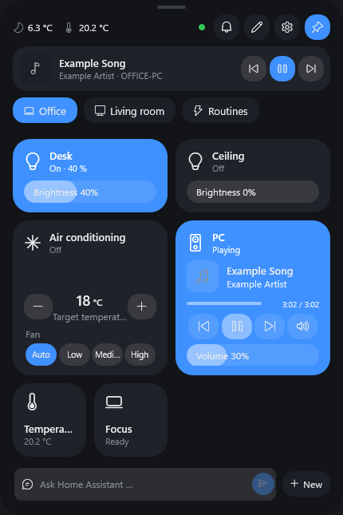

# ue Bar

[English](README.md) · **Deutsch**

Ein ausfahrbares Dashboard am oberen Bildschirmrand von Windows. Maus an den oberen Rand: Eine
kleine Pill erscheint und mit ihr deine Smart-Home-Kacheln, eine Statuszeile, Benachrichtigungen
und eine Schnellsuche. Vorbild ist die „Now Bar“ von Samsung One UI. Home Assistant ist das erste
Plugin; weitere (Windows, Handy, MQTT …) kommen als Plugins dazu, ohne die App neu zu bauen.



| Pill | Bearbeiten | Einstellungen |
|---|---|---|
|  |  |  |

## Funktionen

- **Pill und Panel am oberen Rand**: erscheint nach kurzem Verweilen, bleibt offen, solange die
  Maus darauf ist, oder lässt sich fixieren. Mehrere Monitore, bei Vollbild-Apps ausgeblendet.
- **Kacheln** für Lichter (Helligkeit, Farbtemperatur), Schalter, Skripte und Szenen, Klima
  (auch IR-Klima aus Schalter + Zahl + Auswahl), Medienplayer mit Cover und Steuerung,
  Staubsauger, Sensoren und Auswahllisten – live aktualisiert.
- **Bearbeiten-Modus** direkt im Panel: Kacheln per Suche hinzufügen, Größe ändern, verschieben
  (auch in andere Tabs), Tabs pro Gerät oder für alle, Tabs nur daheim oder nur unterwegs.
- **Statuszeile** mit kleinen Werten (z. B. Wetter, Temperatur) im Panel und in der Pill.
- **Benachrichtigungen** aus Home Assistant: ue Bar meldet sich wie die Companion-App an, du
  schickst also an `notify.mobile_app_ue_bar_<dein_gerät>`.
- **Schnellsuche** mit globalem Tastenkürzel (Standard `Win + Alt + Leertaste`): alles finden und
  schalten, `+ Milch` landet auf der Einkaufsliste.
- **Assist**-Feld: den Sprachassistenten von Home Assistant per Text fragen.
- **Now Playing** in der Pill.
- **Plugins**: neue Kachel-Quellen als ZIP unter Einstellungen → Plugins hinzufügen. ue Bar fragt,
  bevor es ein nicht mitgeliefertes Plugin lädt. Eigene schreiben mit dem
  [Plugin-SDK](docs/WRITING-A-PLUGIN.md) (Englisch).
- **Layout-Sync** über Home Assistant (pro HA-Benutzer), mit lokaler Kopie für unterwegs.
- **Deutsch und Englisch**, im laufenden Betrieb umschaltbar. Zahlen und Uhrzeiten nach der
  Windows-Region.
- OLED-Schutz (Abdunkeln, Pixel-Shift), eingeklappt sparsam mit Ressourcen.

## Voraussetzungen

- Windows 10 (ab Version 1809) oder Windows 11, x64
- .NET 10 Desktop Runtime – der Installer lädt sie bei Bedarf von Microsoft; die portable
  Version braucht sie nicht
- Für das Home-Assistant-Plugin: eine vom PC erreichbare Home-Assistant-Instanz und ein
  langlebiges Zugriffstoken

## Installation

Herunterladen auf der Seite [Releases](../../releases):

- `ueBar-Setup-<version>.exe` – Installer (Deutsch/Englisch, ohne Administratorrechte, nach
  `%LOCALAPPDATA%\Programs\ueBar`)
- `ueBar-<version>-portable.exe` – eine einzelne Datei, nichts zu installieren

**Windows SmartScreen:** Die Dateien sind nicht signiert, deshalb zeigt Windows eventuell „Der
Computer wurde durch Windows geschützt“. Klicke auf **Weitere Informationen → Trotzdem
ausführen**. Im Zweifel selbst aus dem Quellcode bauen (siehe unten).

Einstellungen, Layout und Logs liegen in `%APPDATA%\ueBar`.

## Erste Einrichtung (Home Assistant)

1. In Home Assistant **Profil → Sicherheit → Langlebige Zugriffstoken** öffnen und ein Token
   erstellen, z. B. „ue Bar – mein PC“. Pro Gerät ein eigenes Token.
2. ue Bar starten. Der Willkommens-Assistent fragt nach der Adresse (lokal, z. B.
   `http://homeassistant.local:8123`, und/oder extern, z. B. `https://ha.example.com`) und dem
   Token und testet die Verbindung.
3. Bereiche auswählen, die in die Bar sollen – ue Bar schlägt Tabs und Kacheln aus deinen
   Home-Assistant-Bereichen vor. Alles lässt sich später mit dem Stift ändern.

Alle Einstellungen gibt es auch unter **Einstellungen → Plugins → Home Assistant** (Zahnrad im
Panel oder Doppelklick auf das Tray-Symbol). Das Token wird mit Windows-DPAPI verschlüsselt
gespeichert.

## Benachrichtigungen

Nach dem Verbinden meldet sich ue Bar bei Home Assistant wie die Companion-App an. Home Assistant
bietet dann einen Benachrichtigungsdienst für dieses Gerät:

```yaml
action: notify.mobile_app_ue_bar_mein_pc
data:
  title: Waschmaschine
  message: Die Wäsche ist fertig
```

Den genauen Dienstnamen zeigt **Einstellungen → Plugins → Home Assistant → Diagnose**.

## Aus dem Quellcode bauen

Voraussetzung: [.NET 10 SDK](https://dotnet.microsoft.com/download/dotnet/10.0) unter Windows.

```powershell
dotnet build
dotnet test
dotnet run --project src/UeBar.App
```

Installer und portable Exe (braucht [Inno Setup 6](https://jrsoftware.org/isinfo.php)):

```powershell
powershell -ExecutionPolicy Bypass -File build/publish.ps1
```

Die Ergebnisse landen in `dist/`. Zum Entwickeln die Umgebungsvariable `UEBAR_DATA_DIR` auf einen
Testordner setzen, dann bleiben die echten Einstellungen unberührt. `ueBar.exe --settings` (oder
`--settings=plugins`) öffnet die Einstellungen gleich nach dem Start; `UEBAR_CULTURE=en-US` setzt
das Zahlen- und Datumsformat, ohne die Windows-Region zu ändern.

Weiterlesen (Englisch): [Architektur](docs/ARCHITECTURE.md) · [Plugin schreiben](docs/WRITING-A-PLUGIN.md)
· [Mitmachen](CONTRIBUTING.md) · [Änderungen](CHANGELOG.md)

## Lizenz

Copyright (C) 2026 Dominik Poschinger

ue Bar ist freie Software: Du darfst sie unter den Bedingungen der
[GNU General Public License](LICENSE), Version 3 oder (nach deiner Wahl) jeder späteren Version,
weitergeben und ändern. Sie wird OHNE JEDE GEWÄHRLEISTUNG bereitgestellt. Fremdkomponenten:
[THIRD-PARTY-NOTICES.md](THIRD-PARTY-NOTICES.md).

ue Bar ist **kein** offizielles Projekt von Home Assistant, Nabu Casa oder Samsung. Diese Namen
beschreiben nur, womit ue Bar zusammenarbeitet und woran sich das Design orientiert; es werden
keine Logos davon verwendet.
