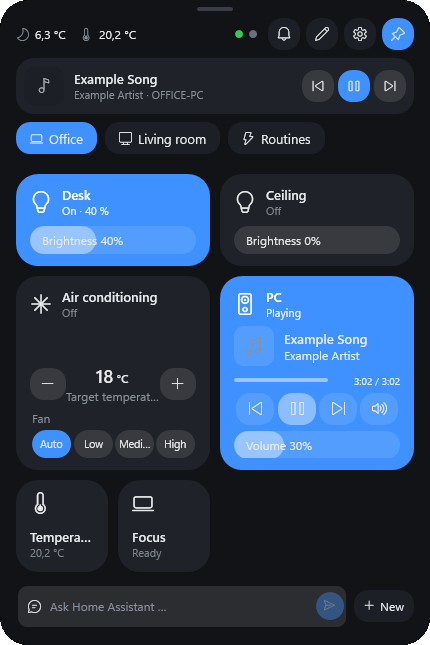
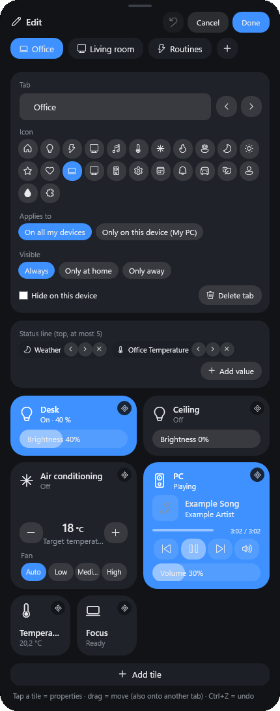
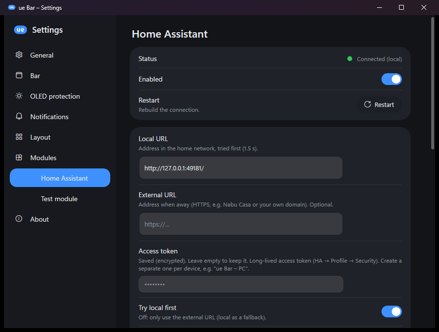

# ue Bar

**English** · [Deutsch](README.de.md)

A slide-out dashboard for the top edge of your Windows screen. Move the mouse to the top
edge: a small pill appears, and with it your smart-home tiles, a status line, notifications and
a quick search. Inspired by the "Now Bar" of Samsung One UI. Home Assistant is the first module;
the app is built so that more modules (Windows, phone, MQTT …) can be added without touching
the core.



| Pill | Edit mode | Settings |
|---|---|---|
|  |  |  |

## Features

- **Pill and panel at the top edge**: appears after a short dwell, stays open while the mouse is
  on it, or pin it to keep it visible. Works with several monitors and hides in fullscreen apps.
- **Tiles** for lights (brightness, color temperature), switches, scripts and scenes, climate
  (including IR climate from switch + number + select), media players with cover and controls,
  vacuums, sensors and selects – updated live.
- **Edit mode** right in the panel: add tiles by searching, resize, move (also to other tabs),
  tabs per device or shared, tabs visible only at home or only away.
- **Status line** with small values (e.g. weather, temperature) in the panel and the pill.
- **Notifications** from Home Assistant: ue Bar registers like the companion app, so you send to
  `notify.mobile_app_ue_bar_<your_device>`.
- **Quick search** with a global hotkey (default `Win + Alt + Space`): find and switch anything,
  `+ milk` adds to the shopping list.
- **Assist** field: ask Home Assistant's voice assistant in text form.
- **Now Playing** in the pill.
- **Layout sync** through Home Assistant (per HA user), with a local copy for offline use.
- **German and English**, switchable at runtime. Numbers and times follow your Windows region.
- OLED protection (dimming, pixel shift), light on resources when collapsed.

## Requirements

- Windows 10 (version 1809 or later) or Windows 11, x64
- .NET 10 Desktop Runtime – the installer downloads it from Microsoft if it is missing; the
  portable version does not need it
- For the Home Assistant module: a Home Assistant instance reachable from the PC and a
  long-lived access token

## Installation

Download from the [Releases](../../releases) page:

- `ueBar-Setup-<version>.exe` – installer (German/English, no admin rights needed, installs to
  `%LOCALAPPDATA%\Programs\ueBar`)
- `ueBar-<version>-portable.exe` – a single file, nothing to install

**Windows SmartScreen:** the files are not code-signed, so Windows may show "Windows protected
your PC". Click **More info → Run anyway**. If in doubt, build it yourself from the source code
(see below).

Settings, layout and logs are stored in `%APPDATA%\ueBar`.

## First setup (Home Assistant)

1. In Home Assistant open your **profile → Security → Long-lived access tokens** and create a
   token, e.g. named "ue Bar – my PC". Create a separate token per device.
2. Start ue Bar. The welcome assistant asks for the address (local, e.g.
   `http://homeassistant.local:8123`, and/or external, e.g. `https://ha.example.com`) and the
   token, and tests the connection.
3. Choose the areas you want in the bar – ue Bar suggests tabs and tiles from your Home
   Assistant areas. Everything can be changed later with the pen icon.

All settings are also available under **Settings → Modules → Home Assistant** (gear icon in the
panel or double-click the tray icon). The token is stored encrypted with Windows DPAPI.

## Notifications

When connected, ue Bar registers with Home Assistant like the mobile companion app. Home
Assistant then offers a notify service for this device:

```yaml
action: notify.mobile_app_ue_bar_my_pc
data:
  title: Washing machine
  message: The laundry is done
```

The exact service name is shown under **Settings → Modules → Home Assistant → Diagnostics**.

## Building from source

Requirements: [.NET 10 SDK](https://dotnet.microsoft.com/download/dotnet/10.0) on Windows.

```powershell
dotnet build
dotnet test
dotnet run --project src/UeBar.App
```

Installer and portable executable (needs [Inno Setup 6](https://jrsoftware.org/isinfo.php)):

```powershell
powershell -ExecutionPolicy Bypass -File build/publish.ps1
```

The results are written to `dist/`. For development, set the environment variable
`UEBAR_DATA_DIR` to a test folder so your real settings stay untouched.

Further reading: [architecture](docs/ARCHITECTURE.md) · [writing a module](docs/WRITING-A-MODULE.md)
· [contributing](CONTRIBUTING.md) · [changelog](CHANGELOG.md)

## License

Copyright (C) 2026 Dominik Poschinger

ue Bar is free software: you can redistribute it and/or modify it under the terms of the
[GNU General Public License](LICENSE), version 3 or (at your option) any later version. It is
distributed WITHOUT ANY WARRANTY. Third-party components: [THIRD-PARTY-NOTICES.md](THIRD-PARTY-NOTICES.md).

ue Bar is **not** an official project of Home Assistant, Nabu Casa or Samsung. These names are
used only to describe what ue Bar works with and what its design is inspired by; no logos of
them are used.
