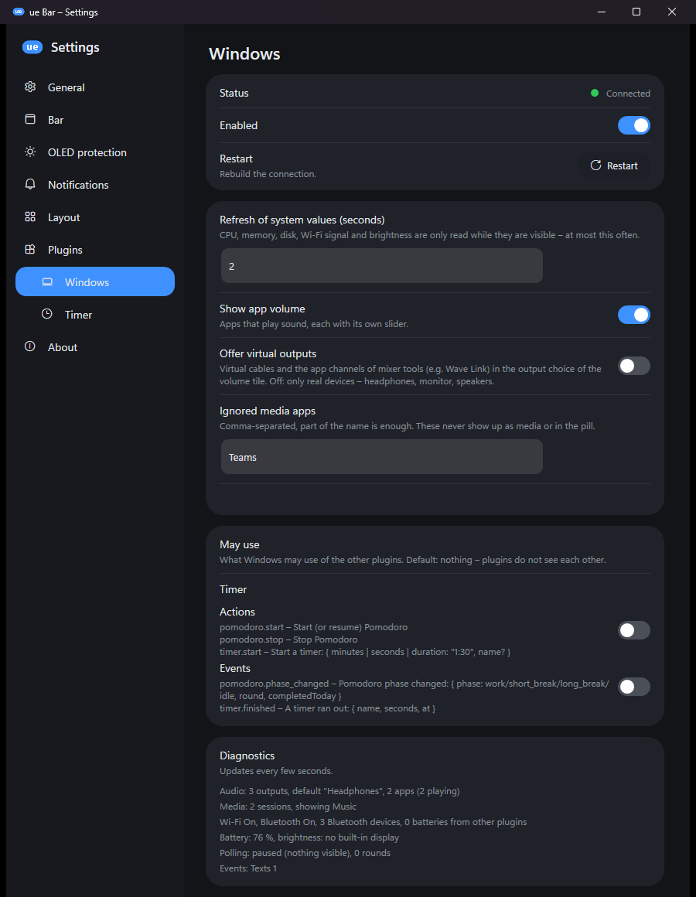

# Architecture

ue Bar is split into a **core** and **modules**. The core provides the bar, tabs, the tile grid,
layout storage, settings, search, notifications and the status line. Modules provide content.
Since 1.2.0 every module is a **plugin**: a folder with a `plugin.json` and its DLLs, loaded at
start-up. Home Assistant is just one plugin. The guiding rule:

> The app must start and run without the Home Assistant plugin. A new module (Windows, phone,
> MQTT, Spotify …) needs no change to the app or the core – only a new plugin project that
> references `UeBar.Sdk`.

## Projects

| Project | Role | References |
|---|---|---|
| `UeBar.Sdk` | the **contract** with plugins: interfaces, models, tile elements, `CoreApiVersion` – no implementation; also shipped as a NuGet package | nothing (no WPF, no NuGet packages) |
| `UeBar.Core` | the implementation: plugin loader, module registry, fault protection, module bus, layout, settings, logging, localization | Sdk |
| `UeBar.Bar` | pure bar logic: state machine, geometry, monitor choice, hotkeys, notification queue, OLED protection | Core |
| `UeBar.App` | the WPF app: bar window, panel, rendering of tiles, settings window, tray, Win32 interop | Core, Bar – **no plugin** |
| `UeBar.Modules.HomeAssistant` (`plugins/HomeAssistant/src`) | plugin `homeassistant`: Home Assistant over WebSocket – tiles, search, status line, notifications (mobile app), Assist, layout sync | Sdk only |
| `UeBar.Modules.Dummy` (`plugins/Dummy/src`) | plugin `dummy`: test module with in-memory devices (debug builds only; a separate ZIP for developers) | Sdk only |
| `samples/HelloPlugin` | sample plugin for plugin authors | Sdk only |

### Repository layout

```
src/        UeBar.App, UeBar.Bar, UeBar.Core, UeBar.Sdk
tests/      tests of the app, bar and core (+ test plugins for the loader)
plugins/
  HomeAssistant/   src/, tests/, README.md, README.de.md, images/
  Dummy/           src/, README.md, README.de.md
samples/HelloPlugin/
docs/       ARCHITECTURE.md, WRITING-A-PLUGIN.md, images/ (the bar and the core only)
```

**Official plugins** – the ones that come with the installer or are maintained with ue Bar – live
in this repository under `plugins/<Name>/`: they ship with the app, are built against the same SDK
version and are tested together with it. Each has its own README (English and German) with
everything specific to it. **Plugins by others** live in their own repositories and only need the
SDK package.

Plugins never reference each other or the app. The app only builds the bundled plugins first and
copies them to `plugins\<id>\` next to it (`build/BundledPlugins.targets`).

## Plugins

A plugin is a folder `<id>\` with `plugin.json` (id, name, description, version, author, license,
homepage, `sdkVersion`, `entryAssembly`), its DLLs and its language files. It is found in two
places:

| Where | What |
|---|---|
| `<app folder>\plugins\` | **bundled** plugins (Home Assistant), with a checksum list `bundled.sha256` written at build time |
| `%APPDATA%\ueBar\plugins\` | plugins the **user** added (Settings → Plugins → Add plugin …) |

The portable single exe carries the bundled plugins inside as a ZIP and unpacks them once per
version to `%LOCALAPPDATA%\ueBar\builtin-plugins\<version>-<checksum>\`. Their checksum list is read
from the exe, not from the unpacked folder, so files changed afterwards are noticed.

Loading (`PluginHost` in the core), only at start-up:

1. **Discover** every folder and read `plugin.json` – no plugin code runs. Checks: required fields,
   the entry DLL exists and is a .NET assembly built against `UeBar.Sdk`, no reference to app
   internals, the interface version fits. A user plugin may not take the ID of a bundled one; of
   two plugins with the same ID only the first counts.
2. **Trust**: a bundled plugin whose files match `bundled.sha256` loads without asking. Every other
   plugin needs the user's permission ("This plugin has full access to your PC …"); the decision
   is stored with the checksum of its code files in `plugin-trust.json`. Changed files → ask again.
3. **Load**: each plugin gets its own `AssemblyLoadContext`. `UeBar.Sdk` and everything the app
   already has (the framework) come from the app – otherwise `IModule` would be two different
   types. The plugin's own dependencies and language files come from its folder. The module class
   is created on the thread pool with a time limit.
4. **Register**: loaded modules go to the module registry. Plugins that are off, not allowed,
   incompatible or broken are registered as "not loaded" with the reason, so their tiles keep a
   fitting placeholder.

Nothing about a plugin can stop the app: every problem becomes the state "Error" (or
"Incompatible") with a reason, shown in Settings → Plugins and once in the tray. Plugins are never
unloaded while the app runs: switching a loaded plugin off stops it right away; switching it on
again, adding, updating or removing a loaded one takes effect after a restart ("Restart now").


## Exit

The app ends in a fixed order, each step timed and logged in one line ("Exit finished in … ms:
tray …, bar …, plugins …, layout …, helpers …, single instance …"):

1. tray icon and bar window (nothing new can be triggered),
2. all plugins **at the same time**, each at most **2 s** (waiting for a start or restart that is
   still running included) – a plugin that does not make it is left behind with its stop token
   cancelled and a warning in the log,
3. layout stores and background helpers (off the UI thread, with a time limit),
4. WPF shutdown.

An exit guard ends the process if it still runs 3 s after the request and logs the stage it hung
in. Plugins get `StopAsync` and their stop token; they must not rely on more time than that.

## Interfaces in `UeBar.Sdk`

| Interface | Purpose |
|---|---|
| `IModule` | `Id`, `DisplayName`, `Icon`, `Status`, `StartAsync`, `StopAsync`, the module's tile types |
| `ITileType` | a tile type (e.g. `ha.light`): name, icon, allowed sizes, slots it needs (e.g. `main`, `power`, `target`), creates a `TileModel` from a `TileConfig` |
| `IModuleContext` | given to `StartAsync`: the module's bus access, logger, stop token, `RunBackground`, data folder |
| `IEntitySource` | searchable, observable things with a default action (edit mode, quick search, tile suggestion) |
| `IStatusProvider` | small values for the status line |
| `INotificationSource` | notifications; the core shows them no matter where they come from |
| `IAssistProvider` | takes text, returns an answer |
| `IModuleSettings` | the module's settings as fields; the core builds the settings page and stores secrets encrypted (DPAPI) |
| `ILayoutStore` / `ILayoutStoreProvider` | where the synchronized base layout lives (local file in the core, Home Assistant in the HA module) |
| `IModuleBus` | communication between modules, only with permission |

Further capabilities are separate optional interfaces (`IModuleDiagnostics`,
`IQuickCommandProvider`, `INowPlayingSource`, `IImageSource`, `IVisibilityAware`,
`IDeviceBatterySource`, `IUiLanguageInfo` and `IDeviceBatteryCatalog` on the context …). Modules
implement only what they need; the core checks with `is`/`as`.

Two of them keep collapsed ue Bar cheap: `IVisibilityAware` tells a module what of it is on screen
(the tiles of the open tab, the status line), so it can poll only while something is visible; the
app passes on only changes. `IDeviceBatterySource`/`IDeviceBatteryCatalog` let one plugin show the
device batteries another plugin knows (e.g. a vendor plugin for a wireless dongle) – the core
collects them, the plugins never see each other.

Contract 1.3 (1.3.2) adds what the quick access plugin needed – all generic, none of it knows that
plugin:

- `ILiveModuleSettings`: a settings change is applied to the running module
  (`ModuleRegistry.ApplyChangedSettingsAsync`); modules without it are restarted as before.
- Settings fields `File`, `Folder` (the app shows the dialog) and `List` (entries with item fields),
  plus `ShowWhen` on any field.
- `IDropHandler`: something dropped on the panel in edit mode goes to the first running module that
  turns it into a tile (`ModuleRegistry.CreateTileForDropAsync`); the app adds the tile.
- `UeNotification.Priority`: important notifications pass a paused bar, "Do not disturb" and the
  fullscreen block as far as the bar settings allow (`NotificationGate` in `UeBar.Bar`).
- `IconGridElement` and `TileModel.ImageUrl` shown as the tile's icon.

## Tiles are data

So that a module needs no WPF code, a tile describes its content as data made from elements,
and the app renders them:

`TileModel` = title, icon, state text, `IsActive` (accent color), optional image, and a list of
elements:

| Element | Example |
|---|---|
| `TapAction` | tap the whole tile = toggle/run |
| `SliderElement` | brightness, volume, temperature |
| `StepperElement` | −/+ with a value (target temperature) |
| `ButtonRowElement` | play/pause/next/previous, start/pause/dock |
| `ChoiceElement` | choice (fan speed, input) |
| `ValueDisplayElement` | large value + unit (sensor) |
| `MediaInfoElement` | cover, title, artist, progress |
| `IconGridElement` | icons with names, e.g. several shortcuts in one tile (1.3) |

Elements are observable (values change live) and report interactions back to the module.
Elements, `TileModel` and the layout are fully JSON-serializable (no WPF or Windows types,
colors as hex strings, icons as names, images as URL or ID) – another device could show and
operate the same tiles.

## Fault protection

A faulty module must never take down the app or other modules.

- Every call from the core into a module (start, stop, create tile, interaction, search, status
  …) goes through the `ModuleGuard`, which catches and logs exceptions with the module ID.
- If a module throws: status "Error", its tiles show a placeholder, all other modules keep
  running. Automatic restart with backoff (at most 3 attempts in 5 minutes), then it waits for a
  manual "Restart".
- Calls from the UI thread have a time limit; a hanging module does not freeze the bar.
- Background work of a module runs through `IModuleContext.RunBackground` with its own
  cancellation token; unobserved exceptions are attributed to the module.
- Rules for module authors: no `async void`, no own timers or threads, thread-safe code; moving
  changes to the UI thread is the app's job.

## Module bus

Modules work together only through the bus in the core:

- A module **publishes** what others may use: actions (e.g. `ha.call_service`), events (e.g.
  `ha.state_changed`) and values.
- Another module calls or subscribes through `IModuleBus` – **only with permission**. The default
  is "denied"; permissions are per pair and direction and stored in the settings.
- Everything on the bus runs through the fault protection; if a module fails, the others get a
  clean error result instead of an exception.

**Permissions in the settings** (since 1.3.1): Settings → Plugins → *a plugin* → **May use** lists
the other plugins with what they publish right now (actions, events, values) and one switch per
provider and kind – what this plugin may use of them. Everything is off by default. A plugin can
ask for a permission (`IModuleBus.RequestPermission`); the request appears as a hint with
**Allow**/**Decline** on the plugin's page and on the Plugins page. The decision is stored in
`settings.json` (`busGrants`) and checked on every call and delivery, so switching it off takes
effect at once. The page is generic: it knows no plugin by name.

First user: the Timer plugin's Pomodoro runs a chosen action of another plugin (e.g. a Home
Assistant script) when work or a break starts – only while it is permitted.



## Layout

- **Base layout** (tabs, tiles, status line): stored by a module that offers a layout store
  (Home Assistant: per HA user in `frontend/user_data`), always with a local copy
  (`layout.json`). Changes made offline are uploaded later; conflicts keep the newer version and
  back up the other one.
- **Device level** (`device.json`): tabs only on this device, base tabs hidden on this device.
- **Location**: tabs can be visible only at home or only away (the HA module knows the location
  from local vs. external connection).
- Tiles of missing, disabled, refused or broken plugins stay in the layout and show a placeholder.

## Stable contracts

The interfaces in `UeBar.Sdk` are the contract between ue Bar and its plugins. The app's look and
behavior can change freely as long as the contract stays the same.

- Interfaces are only **extended** (new optional interfaces), never changed in a breaking way.
  Every extension increases the minor version of `CoreApiVersion` (and of the SDK package).
- New capabilities always come as their own optional interface, so existing plugins keep working.
- A plugin states the version it needs (`sdkVersion`). It loads if the major version is the same
  and the app's minor version is not older.
- If a breaking change is ever unavoidable, the major version is increased and noted in the
  changelog; plugins for the old major version are then not loaded.

## Threads and resources

- Collapsed, the bar renders nothing; the only timer is the mouse polling on a background thread,
  which wakes the UI thread only when needed.
- Modules report changes on any thread; the app marshals them to the UI thread. When it copies a
  tile's element list it retries if the list was changed at the same moment; a module itself makes
  sure that two of its threads never change the same tile at once.
- A UI watchdog writes a small dump to the log folder if the UI thread hangs.

## Languages

Each project has its own texts (`Resources/Strings.resx` English, `Strings.de.resx` German).
The core offers the current UI language to modules through `IUiLanguageInfo` on the module
context. Numbers, dates and times follow the Windows region. Tests check that every key exists
in both languages and that no UI text is hard-wired in the code.
