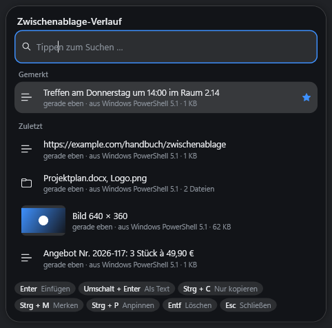

# Zwischenablage-Plugin für ue Bar

[English](README.md) · **Deutsch** · [zurück zu ue Bar](../../README.de.md)

Ein Zwischenablage-Verlauf: Alles, was du kopierst – Text (mit Formatierung), Bilder und Dateien aus dem
Explorer – bleibt eine Weile verfügbar. `Win + V` drücken, Eintrag wählen, und er wird dort eingefügt, wo du
gerade schreibst. Tippen sucht, Einträge, die du öfter brauchst, merkst du dir (★), oder du pinnst sie neben
deine Arbeit. Verschlüsselt nur auf diesem PC gespeichert; Passwortmanager sind ausgenommen. Das Plugin kommt mit
ue Bar (Plugin-ID `clipboard`), ist standardmäßig an und braucht keine Einrichtung.

## Verlauf öffnen

- **`Win + V`** – ue Bar übernimmt dieses Kürzel von Windows (Einstellung **Win+V übernehmen**, standardmäßig an;
  aus = Windows bekommt `Win + V` zurück).
- **`Win + Alt + V`** – das Ersatzkürzel, immer aktiv (in den Einstellungen änderbar).
- **Kachel** „Zwischenablage“ (Bearbeiten-Modus, „Zwischenablage“ suchen), **Schnellsuche** `cb` oder
  „Zwischenablage“ suchen.

Der Verlauf erscheint an der Textmarke des Fensters, in dem du warst (oder an der Maus, wenn die App ihre
Textmarke nicht verrät), auf diesem Monitor und in seiner Skalierung. Dasselbe Kürzel noch einmal schließt ihn.

**Wo er erscheint:** an der Textmarke. ue Bar fragt Windows zuerst auf dem alten Weg (Editor, Word, Excel,
PowerPoint, Photoshop …); Programme, die dort nichts melden – Chrome, Edge, Electron-Apps wie die Claude-App,
Obsidian, Discord oder Spotify, Adressleiste und Suchfeld im Explorer, die Windows-Suche, das Suchfeld der
Einstellungen –, werden über die Barrierefreiheit (UI Automation) gefragt, höchstens 150 ms lang und nur beim Öffnen.
Kennt keiner eine Position, erscheint der Verlauf an der Maus. Beim allerersten Mal nach einem Start braucht ein
Programm manchmal etwas länger, dann erscheint der Verlauf einmal an der Maus.

**Startmenü:** Im Startmenü erscheint der Verlauf zwar an der Textmarke, aber **hinter** dem Startmenü – Windows hält
das Startmenü auf einer Ebene, über die kein normales Programm kommt.

| Taste | Wirkung |
|---|---|
| `Enter` oder Klick | In das vorherige Fenster einfügen: Fokus zurück, Eintrag in die Zwischenablage, `Strg + V` |
| `Umschalt + Enter` | Als reinen Text einfügen (ohne Formatierung; Dateien als Pfade) |
| `Strg + C` | Nur kopieren, nicht einfügen |
| `Strg + M` | Merken an/aus (★) – gemerkte Einträge stehen oben und werden von den Grenzen nie gelöscht |
| `Strg + P` | Auf den Bildschirm anpinnen (als Text- oder Bild-[Pin](../../README.de.md#pins)) |
| `Entf` | Löschen (seine Daten werden sofort gelöscht) |
| `Esc` | Schließen |
| tippen | Suchen – jedes Wort muss vorkommen (Text, Dateinamen, App) |

Die Tasten stehen unten im Verlauf und in den Tooltips. Einfügen aus dem Verlauf legt keinen neuen Eintrag an –
der Eintrag rutscht nur nach oben.

**Merken** und **Anpinnen** sind zwei verschiedene Dinge: *Merken* (★) heißt, ein Eintrag bleibt dauerhaft im
Verlauf. *Anpinnen* heißt, er wird als kleines Fenster auf den Bildschirm geklebt.

## Was aufgezeichnet wird

- **Text** – mit HTML und RTF, wenn die App sie anbietet (je bis 512 KB), damit die Formatierung wieder eingefügt
  werden kann.
- **Bilder** – je bis 10 MB als PNG (Einstellung), mit kleinem Vorschaubild. Ein Bild, das zusammen mit Text kommt
  (z. B. aus Office), bleibt Text.
- **Dateien und Ordner aus dem Explorer** – nur ihre Pfade, nie eine Kopie der Dateien.
- Je Eintrag: Zeit, die App, aus der er kam (Name und Symbol, soweit Windows es verrät), Art und Größe.
- Derselbe Inhalt noch einmal wird nicht doppelt gespeichert – der vorhandene Eintrag rutscht nach oben.

Das Beobachten läuft über die Zwischenablage-Benachrichtigungen von Windows – nichts wird abgefragt, nichts läuft,
solange nichts kopiert wird.

## Grenzen (Einstellungen)

- **Anzahl Einträge:** 100 (gemerkte zählen nicht mit).
- **Tage aufbewahren:** 7 – ältere Einträge werden gelöscht (geprüft beim Start und stündlich); gemerkte bleiben.
- **Bilder speichern** an/aus und **größtes Bild** (10 MB).
- **Gesamtgröße:** 200 MB – wird der Verlauf größer, werden die ältesten nicht gemerkten Einträge gelöscht.

## Private Inhalte

- **Passwortmanager:** Inhalte, die eine App als privat kennzeichnet (`ExcludeClipboardContentFromMonitorProcessing`,
  `CanIncludeInClipboardHistory` = 0, `Clipboard Viewer Ignore` – das tun KeePass, KeePassXC, Bitwarden, 1Password
  und die meisten anderen), werden **nie gelesen** – auch nicht kurz; kein Plugin erfährt davon.
- **Ausgeschlossene Apps** (Einstellung): Was in diesen Apps kopiert wird, wird nie gespeichert. Standard: KeePass,
  KeePassXC, Bitwarden, 1Password, Dashlane, Enpass, NordPass, RoboForm, LastPass, Keeper und Proton Pass.
- **Pausieren:** im Tray-Menü („Zwischenablage-Verlauf pausieren“), auf der Kachel, mit `cb pause` oder in den
  Einstellungen. Kachel und Verlauf zeigen, dass er pausiert ist. Ein Neustart von ue Bar beendet die Pause.
- **Leeren:** `cb leeren` oder in den Einstellungen – „Leeren“ behält die gemerkten Einträge, „Alles leeren“ nicht.

## Wo liegt was? Was wird nie gespeichert?

- **Wo:** `%APPDATA%\ueBar\modules\clipboard\` – `index.clip` (die Liste mit kurzen Vorschauen) und eine Datei je
  Eintrag (`<id>.clip`, dazu `<id>.thumb` für das Vorschaubild eines Bildes). Jede Datei ist mit Windows-DPAPI für
  deinen Windows-Benutzer verschlüsselt: nur du, auf diesem PC, kannst sie lesen. Die Einstellungen zeigen
  „Gespeichert: n Einträge (x MB)“ und einen Knopf, der den Ordner öffnet.
- **Nie gespeichert:** von Passwortmanagern als privat gekennzeichnete Inhalte, alles aus ausgeschlossenen Apps,
  alles während der Pause, Bilder, wenn Bilder aus sind oder größer als die Grenze.
- **Verlässt nie diesen PC:** Der Verlauf wird nicht synchronisiert, steht nicht im Layout, geht nie an Home
  Assistant und nie in den Log (dort stehen nur Art und Größe, z. B. „Stored text (86 bytes)“).
- **Löschen** eines Eintrags löscht seine Dateien sofort; Dateien, die zu keinem Eintrag gehören, werden beim
  nächsten Start gelöscht.

## Schnellsuche und andere Plugins

- `cb <Wörter>` zeigt die passenden Einträge; `Enter` kopiert den besten (oder einen anderen mit den Pfeiltasten).
- `cb` allein öffnet den Verlauf, `cb pause` pausiert (oder setzt fort), `cb leeren` leert ihn.
- **Bus** (nur mit Freigabe, siehe Einstellungen → Plugins): Ereignis `clipboard.changed` mit Art, Größe und App –
  **nie der Inhalt**; Aktion `clipboard.copy_text` (`{"text": "…"}`) legt Text in die Zwischenablage; Aktion
  `clipboard.recent` liefert die neuesten Texte **nur**, wenn du **Inhalte mit anderen Plugins teilen** einschaltest.

## Der Zwischenablage-Verlauf von Windows

Ist der Verlauf von Windows zusätzlich eingeschaltet, speichern beide, was du kopierst. Du kannst ihn unter
Windows-Einstellungen → System → Zwischenablage ausschalten, musst aber nicht – `Win + V` öffnet so oder so den
Verlauf von ue Bar, solange **Win+V übernehmen** an ist.

`Win + V` wird mit einem schlanken Tastaturhook übernommen, der nur dieses Kürzel erkennt und sofort zurückkehrt.
Erlaubt Windows das nicht, steht es in den Einstellungen, und `Win + Alt + V` funktioniert stattdessen.
