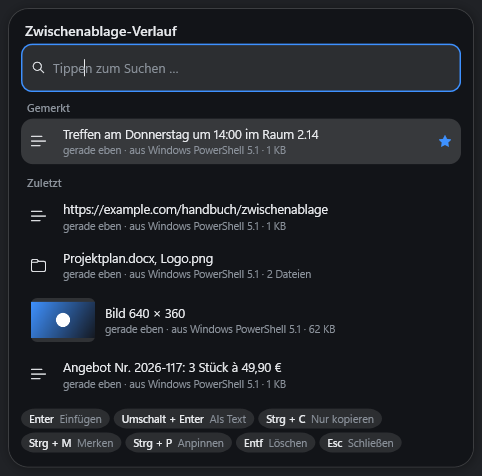

# Clipboard plugin for ue Bar

**English** · [Deutsch](README.de.md) · [back to ue Bar](../../README.md)

A clipboard history: everything you copy – text (with its formatting), images and files from Explorer – stays
available for a while. Press `Win + V`, pick an entry, and it is pasted where you were typing. Search by typing,
keep entries you need again (★), pin them next to your work. Stored encrypted on this PC only; password managers
are left out. The plugin comes with ue Bar (plugin ID `clipboard`), is on by default and needs no setup.

## Opening the history

- **`Win + V`** – ue Bar takes this hotkey over from Windows (setting **Take over Win+V**, on by default; off =
  Windows gets `Win + V` back).
- **`Win + Alt + V`** – the replacement hotkey, always active (changeable in the settings).
- **Tile** "Clipboard" (edit mode, search "Clipboard"), **quick search** `cb`, or search "clipboard".

The history opens at the text cursor of the window you were in (or at the mouse, if the app does not tell where
its cursor is), on that monitor and in its scaling. The same hotkey again closes it.

**Where it appears:** at the text cursor. ue Bar first asks Windows the old way (Notepad, Word, Excel, PowerPoint,
Photoshop …); apps that do not answer there – Chrome, Edge, Electron apps such as the Claude app, Obsidian, Discord or
Spotify, Explorer's address bar and search box, Windows search, the search box of Settings – are asked through
accessibility (UI Automation), at most 150 ms and only when the history opens. If neither knows a position, the
history opens at the mouse. The very first time after a start an app may take a little longer and the history appears
at the mouse once.

| Key | What it does |
|---|---|
| `Enter` or a click | Paste into the window you were in: focus back, the entry on the clipboard, `Ctrl + V` |
| `Shift + Enter` | Paste as plain text (no formatting; files as their paths) |
| `Ctrl + C` | Copy only, do not paste |
| `Ctrl + M` | Keep / no longer keep (★) – kept entries stay at the top and are never deleted by the limits |
| `Ctrl + P` | Pin it on the screen (as a text or image [pin](../../README.md#pins)) |
| `Delete` | Delete it (its data is deleted at once) |
| `Esc` | Close |
| typing | Search – every word must appear (text, file names, app) |

The keys are shown at the bottom of the history and in the tooltips. Pasting from the history does not add a new
entry – the entry only moves to the top.

**Keep** and **pin** are different things: *keep* (★) means an entry stays in the history for good; *pin* means
it is put on the screen as a small window.

## What is recorded

- **Text** – with HTML and RTF if the app offers them (up to 512 KB each), so formatting can be pasted again.
- **Images** – up to 10 MB each as PNG (setting), with a small preview picture. A picture that comes together
  with text (e.g. from Office) stays text.
- **Files and folders from Explorer** – only their paths, never a copy of the files.
- Per entry: time, the app it came from (name and icon, as far as Windows tells), kind and size.
- The same content again is not stored twice – the existing entry moves to the top.

Watching works through Windows' clipboard notifications – nothing is polled, nothing runs while nothing is copied.

## Limits (settings)

- **Number of entries:** 100 (kept entries do not count).
- **Days to keep:** 7 – older entries are deleted (checked at start and every hour); kept ones stay.
- **Store images** on/off and **largest image** (10 MB).
- **Total size:** 200 MB – when the history gets larger, the oldest entries that are not kept are deleted.

## Private content

- **Password managers:** content that an app marks as private (`ExcludeClipboardContentFromMonitorProcessing`,
  `CanIncludeInClipboardHistory` = 0, `Clipboard Viewer Ignore` – KeePass, KeePassXC, Bitwarden, 1Password and
  most others do this) is **never read** – not even briefly; no plugin hears of it.
- **Excluded apps** (setting): nothing copied in these apps is stored. By default KeePass, KeePassXC,
  Bitwarden, 1Password, Dashlane, Enpass, NordPass, RoboForm, LastPass, Keeper and Proton Pass.
- **Pause:** in the tray menu ("Pause clipboard history"), on the tile, with `cb pause` or in the settings. The
  tile and the history show that it is paused. A restart of ue Bar ends the pause.
- **Clear:** `cb clear` (`cb leeren`) or in the settings – "Clear" keeps the kept entries, "Clear everything"
  does not.

## Where is what? What is never stored?

- **Where:** `%APPDATA%\ueBar\modules\clipboard\` – `index.clip` (the list with short previews) and one file
  per entry (`<id>.clip`, plus `<id>.thumb` for an image's preview). Every file is encrypted with Windows DPAPI
  for your Windows user: only you, on this PC, can read them. The settings show "Stored: n entries (x MB)" and
  a button to open the folder.
- **Never stored:** content marked as private by password managers, anything from excluded apps, anything while
  paused, images when images are off or larger than the limit.
- **Never leaves this PC:** the history is not synchronized, not in the layout, never sent to Home Assistant and
  never written to the log (the log only says kind and size, e.g. "Stored text (86 bytes)").
- **Deleting** an entry deletes its files at once; files no entry knows are deleted at the next start.

## Quick search and other plugins

- `cb <words>` shows the matching entries; `Enter` copies the best one (or pick another one with the arrow keys).
- `cb` alone opens the history, `cb pause` pauses (or resumes), `cb clear` / `cb leeren` empties it.
- **Bus** (only with a permission, see Settings → Plugins): event `clipboard.changed` with kind, size and app –
  **never the content**; action `clipboard.copy_text` (`{"text": "…"}`) puts text on the clipboard; action
  `clipboard.recent` returns the latest texts **only** if you switch on **Share contents with other plugins**.

## The Windows clipboard history

If the clipboard history of Windows is switched on as well, both keep what you copy. You can switch it off under
Windows Settings → System → Clipboard, but you do not have to – `Win + V` opens ue Bar's history either way while
**Take over Win+V** is on.

`Win + V` is taken over with a small keyboard hook that only recognizes this key and returns at once. If Windows
does not allow it, the settings say so and `Win + Alt + V` works instead.
