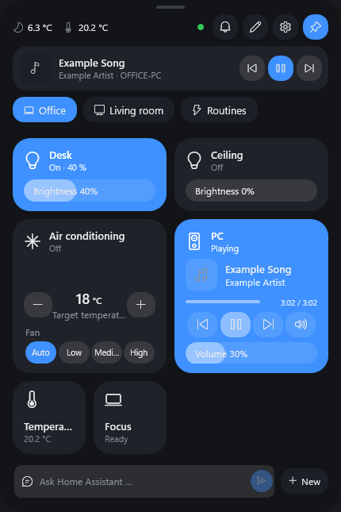
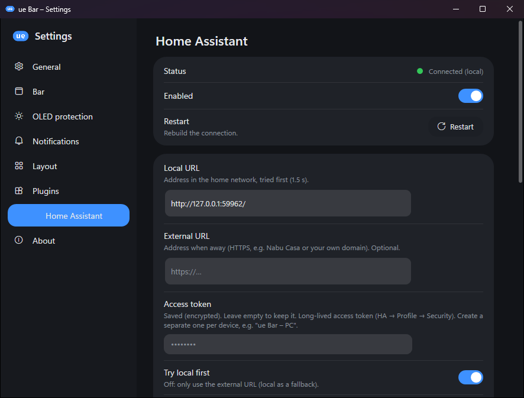

# Home-Assistant-Plugin für ue Bar

[English](README.md) · **Deutsch** · [zurück zu ue Bar](../../README.de.md)

Bringt dein [Home Assistant](https://www.home-assistant.io/) in ue Bar: Kacheln für deine Geräte,
Benachrichtigungen, Assist, eine Schnellsuche über alle Entitäten und dein Layout synchron pro
Home-Assistant-Benutzer. Das Plugin wird mit ue Bar mitgeliefert (Plugin-ID `homeassistant`) und
lässt sich unter **Einstellungen → Plugins** ausschalten.





## Voraussetzungen

- Eine vom PC erreichbare Home-Assistant-Instanz – im Heimnetz und/oder von außen (HTTPS, z. B.
  Nabu Casa oder eigene Domain)
- Ein langlebiges Zugriffstoken. Ein Admin-Benutzer ist **nicht** nötig (siehe
  [unten](#benutzer-ohne-admin-rechte)).

## Erste Einrichtung

1. In Home Assistant **Profil → Sicherheit → Langlebige Zugriffstoken** öffnen und ein Token
   erstellen, z. B. „ue Bar – mein PC“. Pro Gerät ein eigenes Token, dann lässt sich eines
   widerrufen, ohne die anderen anzufassen.
2. ue Bar starten. Der Willkommens-Assistent fragt nach den Adressen und dem Token und testet die
   Verbindung:
   - **Lokale URL**, z. B. `http://homeassistant.local:8123` – wird zuerst versucht, mit kurzem
     Zeitlimit
   - **Externe URL**, z. B. `https://ha.example.com` – wenn die lokale nicht erreichbar ist
     (unterwegs); optional
   - **Lokal zuerst versuchen** – aus: nur die externe Adresse, die lokale als Rückfall
3. Bereiche auswählen, die in die Bar sollen – ue Bar schlägt Tabs und Kacheln aus deinen
   Home-Assistant-Bereichen vor. Alles lässt sich später mit dem Stift ändern.

Alle Einstellungen gibt es unter **Einstellungen → Plugins → Home Assistant** (Zahnrad im Panel
oder Doppelklick auf das Tray-Symbol). Das Token wird mit Windows-DPAPI für deinen
Windows-Benutzer verschlüsselt gespeichert und landet nie im Layout oder im Log.

Bricht die Verbindung ab, verbindet sich ue Bar selbst wieder (mit wachsenden Pausen), wechselt
zurück auf die lokale Adresse, sobald sie wieder erreichbar ist, und prüft die Verbindung nach
einem Netzwechsel oder dem Aufwachen aus dem Standby.

## Kacheln

| Kachel | Für | Zeigt / macht |
|---|---|---|
| Licht | `light` | an/aus, Helligkeit, Farbtemperatur |
| Schalter | `switch`, `input_boolean`, `fan` | an/aus |
| Skript/Szene | `script`, `scene`, `button`, `input_button` | ausführen |
| Klima | `climate` | Modus, Zieltemperatur, aktuelle Temperatur |
| Klima (IR) | Schalter + Zahl + Auswahl | ein IR-Klimagerät aus Helfern: Ein/Aus, Zieltemperatur, Lüfter |
| Medien | `media_player` | Cover, Titel, Play/Pause, zurück/weiter, Lautstärke, Stumm, Ein/Aus |
| Staubsauger | `vacuum` (+ Akku-Sensor) | Zustand, Akku, Start, Pause, zur Station |
| Sensor | `sensor`, `binary_sensor` | Wert mit Einheit |
| Auswahl | `select`, `input_select` | Option wählen |
| Allgemein | alles andere | Zustand, Antippen schaltet um, wenn möglich |

Kacheln fügst du im Bearbeiten-Modus per Suche nach Name, Entitäts-ID oder Bereich hinzu. Sie
werden live aktualisiert; nach dem Antippen zeigt eine Kachel sofort den erwarteten Zustand und
korrigiert sich, wenn Home Assistant antwortet.

**Statuszeile** und **Now Playing**: Jede Entität kann in die Statuszeile (z. B. Wetter,
Temperatur). Now Playing in der Pill nimmt die Medienplayer aus deinem Layout oder die unter
**Now Playing: Medienplayer** gewählten.

## Benachrichtigungen

Nach dem Verbinden meldet sich ue Bar bei Home Assistant wie die Companion-App an (als
„ue Bar – <Gerätename>“, den Gerätenamen stellst du unter Einstellungen → Allgemein ein). Home
Assistant bietet dann einen Benachrichtigungsdienst für diesen PC:

```yaml
action: notify.mobile_app_ue_bar_mein_pc
data:
  title: Waschmaschine
  message: Die Wäsche ist fertig
```

Den genauen Dienstnamen zeigt **Einstellungen → Plugins → Home Assistant → Diagnose**.
Benachrichtigungen erscheinen im Panel und bleiben im Verlauf.

## Schnellsuche und Assist

- **Schnellsuche** (`Win + Alt + Leertaste`): findet jede Entität nach Name, ID oder Bereich und
  schaltet sie sofort. `+ Milch` setzt „Milch“ auf eine Todo-Liste – die unter **Liste für „+ …“**
  gewählte oder die erste, die Home Assistant hat.
- **Assist**: den Assistenten von Home Assistant per Text fragen („Schalte das Licht im Büro
  aus“). Verwendet wird die Assist-Pipeline, die zur Sprache von ue Bar passt (sonst deine
  bevorzugte); der Zusammenhang des Gesprächs bleibt erhalten.

## Layout-Sync

Mit diesem Plugin liegt dein Layout pro HA-Benutzer in Home Assistant (dort, wo auch das
HA-Frontend seine Benutzer-Einstellungen ablegt), mit einer lokalen Kopie in
`%APPDATA%\ueBar\layout.json`. Änderst du das Layout an einem PC, ziehen deine anderen PCs mit
demselben HA-Benutzer nach. Offline-Änderungen werden hochgeladen, sobald die Verbindung wieder da
ist. Tabs lassen sich weiterhin auf ein Gerät beschränken.

## Benutzer ohne Admin-Rechte

Alles funktioniert mit einem normalen Home-Assistant-Benutzer, z. B. für Familienmitglieder:

- Namen, Bereiche und Zustände, die Suche, Kacheln, Dienstaufrufe, Assist, das Layout pro Benutzer
  und die Benachrichtigungen (über die Companion-App-Anmeldung) sind für jeden Benutzer erlaubt
- gibt Home Assistant die Entitäten-Registry nicht heraus, nimmt ue Bar die Anzeigeliste und
  danach nur die Zustände; ohne Bereiche schlägt die Ersteinrichtung Tabs nach Geräteart vor

Die Diagnose zeigt den Benutzer und ob er Admin ist.

## Diagnose

**Einstellungen → Plugins → Home Assistant → Diagnose** zeigt die Verbindung (Server, lokal oder
extern, HA-Version, verbunden seit), den Benutzer, die Entitäten im Layout und welche in Home
Assistant fehlen, die Registry, das Layout in HA, den Benachrichtigungsdienst, Now Playing und den
letzten Fehler. **Neu starten** baut die Verbindung neu auf. Details stehen im Log unter
`%APPDATA%\ueBar\logs` (mit `UEBAR_LOG_LEVEL=Debug` mehr).

## Quellcode

`src/` das Plugin (referenziert nur das ue-Bar-SDK, siehe
[Plugin schreiben](../../docs/WRITING-A-PLUGIN.md), Englisch), `tests/` seine Tests gegen einen
nachgebauten Home-Assistant-Server.
