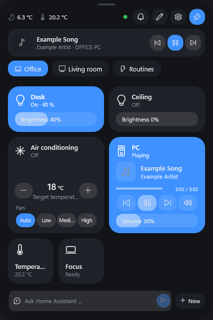
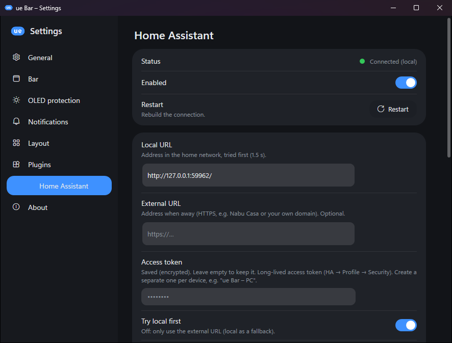

# Home Assistant plugin for ue Bar

**English** · [Deutsch](README.de.md) · [back to ue Bar](../../README.md)

Brings your [Home Assistant](https://www.home-assistant.io/) into ue Bar: tiles for your devices,
notifications, Assist, a quick search over all entities and your layout synced per Home
Assistant user. The plugin comes with ue Bar (plugin ID `homeassistant`) and can be switched off
under **Settings → Plugins**.





## Requirements

- A Home Assistant instance reachable from the PC – in the home network and/or from outside
  (HTTPS, e.g. Nabu Casa or your own domain)
- A long-lived access token. An admin user is **not** needed (see [below](#users-without-admin-rights)).

## First setup

1. In Home Assistant open your **profile → Security → Long-lived access tokens** and create a
   token, e.g. named "ue Bar – my PC". Create a separate token per device, so you can revoke one
   without touching the others.
2. Start ue Bar. The welcome assistant asks for the addresses and the token and tests the
   connection:
   - **Local URL**, e.g. `http://homeassistant.local:8123` – tried first, with a short time limit
   - **External URL**, e.g. `https://ha.example.com` – used when the local one cannot be reached
     (away from home); optional
   - **Try local first** – off: only the external address is used, the local one as a fallback
3. Choose the areas you want in the bar – ue Bar suggests tabs and tiles from your Home Assistant
   areas. Everything can be changed later with the pen icon.

All settings are under **Settings → Plugins → Home Assistant** (gear icon in the panel, or
double-click the tray icon). The token is stored encrypted with Windows DPAPI for your Windows
user, it is never written to the layout or the log.

When the connection drops, ue Bar reconnects by itself (with increasing pauses), switches back to
the local address as soon as it is reachable again, and checks the connection after a network
change or waking up from standby.

## Tiles

| Tile | For | Shows / does |
|---|---|---|
| Light | `light` | on/off, brightness, color temperature |
| Switch | `switch`, `input_boolean`, `fan` | on/off |
| Script/scene | `script`, `scene`, `button`, `input_button` | runs it |
| Climate | `climate` | mode, target temperature, current temperature |
| Climate (IR) | a switch + a number + a select | an IR air conditioner built from helpers: power, target temperature, fan |
| Media | `media_player` | cover, title, play/pause, previous/next, volume, mute, power |
| Vacuum | `vacuum` (+ battery sensor) | state, battery, start, pause, back to the dock |
| Sensor | `sensor`, `binary_sensor` | value with unit |
| Select | `select`, `input_select` | choose an option |
| General | everything else | state, tap toggles if possible |

Add tiles in the edit mode by searching for a name, an entity ID or an area. Tiles update live;
after a tap a tile shows the expected state right away and corrects itself when Home Assistant
answers.

**Status line** and **Now Playing**: any entity can be put in the status line (e.g. weather,
temperature). Now Playing in the pill uses the media players in your layout, or the ones chosen
under **Now Playing: media players**.

## Notifications

When connected, ue Bar registers with Home Assistant like the mobile companion app (as
"ue Bar – <device name>", the device name is set under Settings → General). Home Assistant then
offers a notify service for this PC:

```yaml
action: notify.mobile_app_ue_bar_my_pc
data:
  title: Washing machine
  message: The laundry is done
```

The exact service name is shown under **Settings → Plugins → Home Assistant → Diagnostics**.
Notifications appear in the panel and are kept in the history.

## Quick search and Assist

- **Quick search** (`Win + Alt + Space`): finds every entity by name, ID or area and switches it
  right away. `+ milk` adds "milk" to a to-do list – the one chosen under **List for "+ …"**, or
  the first one Home Assistant has.
- **Assist**: ask Home Assistant's assistant in text form ("Turn off the lights in the office").
  It uses the Assist pipeline that matches the ue Bar language (otherwise your preferred one) and
  keeps the context of the conversation.

## Layout sync

With this plugin, your layout is stored in Home Assistant per HA user (the same place the HA
frontend keeps its own user settings), with a local copy in `%APPDATA%\ueBar\layout.json`. Change
the layout on one PC and your other PCs with the same HA user follow. Offline changes are uploaded
when the connection is back. Tabs can still be limited to one device.

## Users without admin rights

Everything works with a normal Home Assistant user, e.g. for family members:

- names, areas and states, the search, tiles, service calls, Assist, the layout per user and the
  notifications (through the companion-app registration) are allowed for every user
- if Home Assistant does not hand out the entity registry, ue Bar falls back to the display list
  and then to the states alone; without areas the first setup suggests tabs by device type

The diagnostics page shows the user and whether it is an admin.

## Diagnostics

**Settings → Plugins → Home Assistant → Diagnostics** shows the connection (server, local or
external, HA version, connected since), the user, the entities in the layout and those missing in
Home Assistant, the registry, the layout in HA, the notify service, Now Playing and the last
error. **Restart** rebuilds the connection. Details are in the log under `%APPDATA%\ueBar\logs`
(set `UEBAR_LOG_LEVEL=Debug` for more).

## Source

`src/` the plugin (references only the ue Bar SDK, see [writing a plugin](../../docs/WRITING-A-PLUGIN.md)),
`tests/` its tests against a fake Home Assistant server.
