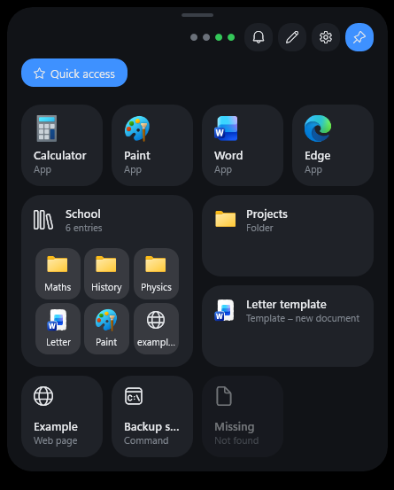
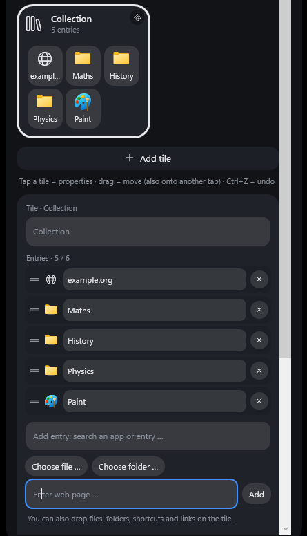

# Schnellzugriff-Plugin für ue Bar

[English](README.md) · **Deutsch** · [zurück zu ue Bar](../../README.de.md)

Apps aus dem Startmenü, Dateien, Office-Vorlagen, Ordner, Webseiten und eigene Befehle als
Kacheln – einzeln oder bis zu sechs in einer Sammel-Kachel (z. B. „Schule“ mit den Ordnern deiner
Fächer). Mit den echten Symbolen aus Windows, in der Schnellsuche und per Ziehen und Ablegen. Das
Plugin kommt mit der ue Bar (Plugin-ID `quickaccess`), ist standardmäßig an und braucht keine
Einrichtung.

## Kacheln anlegen

- **Bearbeiten-Modus → Kachel hinzufügen:** nach einer App aus dem Startmenü suchen (klassische und
  Store-Apps), nach einem deiner Einträge (unten) oder nach „Sammlung“.
- **Ziehen und Ablegen:** Im Bearbeiten-Modus eine Datei, einen Ordner, eine Verknüpfung (`.lnk`),
  eine Internetverknüpfung (`.url`) oder einen Link aus der Adresszeile des Browsers aufs Panel
  ziehen – daraus wird eine Kachel im aktuellen Tab. Eine Verknüpfung auf einen Ordner wird der
  Ordner, jede andere bleibt die Verknüpfung (mit ihren Argumenten).
- **Sammlung:** „Sammlung“ (2x2) hinzufügen und direkt in der Bar füllen – siehe unten.

## Eine Sammlung in der Bar bauen

Im Bearbeiten-Modus die Sammel-Kachel antippen. Ihre Eigenschaften zeigen die **Einträge** (bis zu
sechs):

- **Eintrag hinzufügen:** einen Teil des Namens tippen – Startmenü-Apps und deine Einträge – und einen
  Treffer antippen; **Datei wählen …** / **Ordner wählen …**; **Webseite eingeben …** (`example.org`
  reicht).
- Eine Datei, einen Ordner, eine Verknüpfung oder einen Link **auf die Sammel-Kachel ziehen** – er
  landet darin (aufs übrige Panel gezogen wird es wie bisher eine eigene Kachel).
- **Umsortieren** am Griff ziehen, **umbenennen** im Namensfeld (leer = Name aus dem Ziel),
  **entfernen** mit ×. Die Sammlung selbst benennst du um wie jede Kachel.

Die Einträge liegen in der Sammel-Kachel selbst, also im Layout: Sie kommen auf deine anderen PCs mit,
und „Abbrechen“ im Bearbeiten-Modus verwirft auch Änderungen daran. Ein entfernter Eintrag hinterlässt
nichts.

## Was ein Tippen macht

| Art | Öffnet |
|---|---|
| App | die App, wahlweise als Administrator (Windows fragt wie gewohnt nach) |
| Datei | mit der Standard-App; **Office-Vorlagen** (`.dotx`, `.xltx`, `.potx` …) öffnen ein **neues Dokument** aus der Vorlage (kennt keine App „Neu“, die Vorlage selbst) |
| Ordner | im Explorer |
| Webseite | im Standardbrowser (nur `https://`, `http://`, `mailto:`) |
| Befehl | ein eigenes Skript (`.ps1`, `.bat`) oder eine Befehlszeile – **für Fortgeschrittene** |

Fehlt ein Ziel (Datei verschoben, USB-Stick nicht da, App deinstalliert), zeigt die Kachel **„Nicht
gefunden“** und bleibt – die ue Bar schaut bei jedem Öffnen des Panels erneut nach.

## Einträge (Einstellungen)

**Einstellungen → Plugins → Schnellzugriff → Einträge:** deine eigenen Verknüpfungen auf diesem PC
mit Name, Art und Ziel (Datei und Ordner mit „Durchsuchen …“). Sie erscheinen in der Suche – auch
zum Anlegen von Kacheln und Sammlungs-Einträgen – und andere Plugins können sie über ihre ID öffnen
(Modul-Bus, unten).

Die Seite ist kompakt: eine Zeile pro Eintrag (Symbol, Name, Art, gekürztes Ziel), ein Klick klappt die
Felder auf, ein Suchfeld filtert. Gruppiert nach Verwendung: **Einzelne Kacheln**, je **Sammlung**,
**Nicht verwendet**. Was nur im Layout liegt (ein auf die Sammlung gezogener Ordner), steht mit dabei,
markiert mit „in der Bar bearbeiten“.

**Befehle** laufen mit deinen Rechten, genau so, wie du sie einträgst (PowerShell-Skripte in
PowerShell, die Ausführungsrichtlinie deines PCs gilt). Trag nur ein, was du kennst. Eine
Befehls-Kachel im Layout verweist nur auf den Eintrag dieses PCs: Ein Layout, das von woanders
synchronisiert wird, kann nie einen Befehl mitbringen. Auf einem PC ohne diesen Eintrag zeigt die
Kachel „Nicht gefunden“.

## Mehrere PCs (Layout-Sync)

Pfade unter deinem Benutzerordner werden als `%USERPROFILE%\…` gespeichert – ein synchronisiertes
Layout öffnet `%USERPROFILE%\Documents\Schule` auf jedem PC, egal wie der Benutzerordner dort heißt.

## Schnellsuche

Win+Alt+Leertaste, einen Teil des Namens tippen, **Enter** – die App (Datei, Ordner …) startet und
bekommt den Fokus, nicht die Bar.

## Modul-Bus

| Art | ID | Inhalt |
|---|---|---|
| Aktion | `quickaccess.open` | `{ "id": "<Eintrags-ID>" }` – öffnet einen Eintrag der Einstellungen |

Wie alles über den Bus nur mit Freigabe (Einstellungen → Plugins → das andere Plugin → „Darf nutzen“).

## Ressourcen

Eingeklappt läuft nichts. Die Startmenü-Apps werden einmal gelesen, wenn sie gebraucht werden
(Suche, eine Kachel mit einer App), und beim Suchen höchstens alle 10 Minuten neu; Symbole werden
gelesen, wenn eine Kachel sichtbar wird, und behalten (höchstens 128).

## Für Entwickler

Das Plugin spricht mit Windows nur über `Platform/IQuickShell` (Startmenü-Apps über den
„Apps“-Ordner der Shell, Starten über `ShellExecuteEx`, Verknüpfungen über `IShellLink`, Symbole über
`IShellItemImageFactory` als PNG). Die Tests (`plugins/QuickAccess/tests`) laufen mit einer
Fake-Shell: jede Art von Ziel, Vorlagen, `%USERPROFILE%`-Pfade hin und zurück, „Nicht gefunden“,
Ablegen von Dateien/Ordnern/`.lnk`/`.url`/Links, die Sammel-Kachel, die Suche und der Bus.
