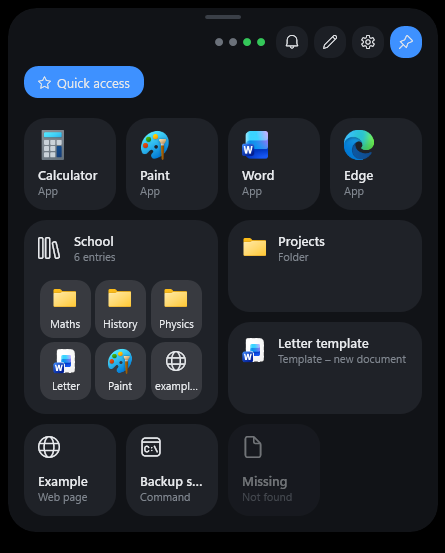
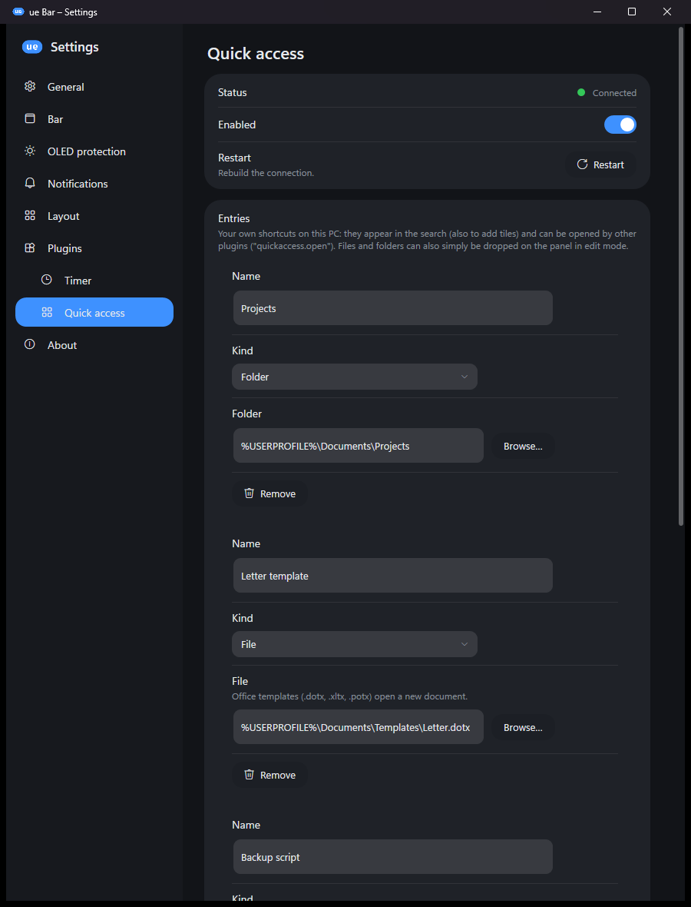

# Quick access plugin for ue Bar

**English** · [Deutsch](README.de.md) · [back to ue Bar](../../README.md)

Apps from the Start menu, files, Office templates, folders, web pages and your own commands as
tiles – one per tile or up to six in one collection tile (e.g. "School" with the folders of your
subjects). With the real icons from Windows, in the quick search and by drag and drop. The plugin
comes with ue Bar (plugin ID `quickaccess`), is on by default and needs no setup.

## Adding tiles

- **Edit mode → Add tile:** search for an app of the Start menu (classic and Store apps), one of
  your entries (see below) or "Collection".
- **Drag and drop:** in edit mode, drag a file, folder, shortcut (`.lnk`), Internet shortcut
  (`.url`) or a link from the browser's address bar onto the panel – it becomes a tile in the
  current tab. A shortcut to a folder becomes the folder; any other shortcut stays the shortcut (it
  keeps its arguments).
- **Collection:** add "Collection" (2x2) and pick up to six entries for its slots – apps, files,
  folders, web pages. Give it a name in edit mode (e.g. "School").

## What a tap does

| Kind | Opens |
|---|---|
| App | the app, optionally as administrator (Windows asks as usual) |
| File | with its default app; **Office templates** (`.dotx`, `.xltx`, `.potx` …) open a **new document** from the template (if no app knows "new", the template itself) |
| Folder | in Explorer |
| Web page | in your default browser (only `https://`, `http://`, `mailto:`) |
| Command | your own script (`.ps1`, `.bat`) or command line – **for advanced users** |

A target that is missing (file moved, USB stick not plugged in, app uninstalled) shows **"Not
found"** and stays – ue Bar looks again whenever the panel opens.

## Entries (settings)

**Settings → Plugins → Quick access → Entries:** your own shortcuts on this PC with name, kind and
target (file and folder with "Browse…"). They appear in the search – also to add tiles – and other
plugins can open them by ID (module bus, below).

**Commands** run with your rights, exactly as you enter them (PowerShell scripts in PowerShell, the
execution policy of your PC applies). Only enter what you know. A command tile in the layout only
points to the entry of this PC: a layout synced from somewhere else can never bring a command with
it. On a PC without that entry the tile says "Not found".

## Several PCs (layout sync)

Paths below your user folder are stored as `%USERPROFILE%\…` – a synced layout opens
`%USERPROFILE%\Documents\School` on every PC, whatever the user folder is called there.

## Quick search

Win+Alt+Space, type a part of the name, **Enter** – the app (file, folder …) starts and gets the
focus, not the bar.

## Module bus

| Kind | ID | Content |
|---|---|---|
| Action | `quickaccess.open` | `{ "id": "<entry ID>" }` – opens an entry of the settings |

Like everything on the bus, only with permission (Settings → Plugins → the other plugin → "May use").

## Resources

Nothing runs while the bar is collapsed. The Start menu apps are read once when needed (search, a
tile with an app) and again at most every 10 minutes when searching; icons are read when a tile is
shown and kept (at most 128).

## For developers

The plugin talks to Windows only through `Platform/IQuickShell` (Start menu apps via the shell's
"Apps" folder, starting via `ShellExecuteEx`, shortcuts via `IShellLink`, icons via
`IShellItemImageFactory` as PNG). The tests (`plugins/QuickAccess/tests`) use a fake shell: every kind
of target, templates, `%USERPROFILE%` paths both ways, "Not found", dropping files/folders/`.lnk`/
`.url`/links, the collection tile, the search and the bus.
