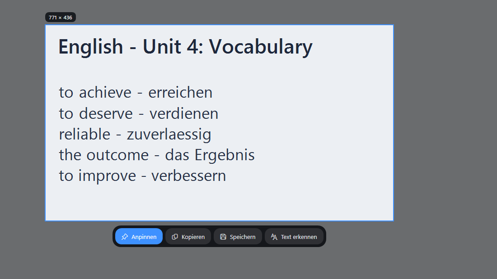
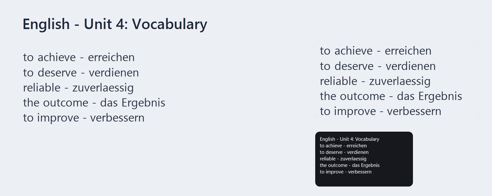

# Screenshot-Plugin für die ue Bar

[English](README.md) · **Deutsch** · [zurück zur ue Bar](../../README.de.md)

Einen Bereich, ein Fenster oder einen ganzen Bildschirm aufnehmen – und dann neben die Arbeit
anpinnen, kopieren, speichern oder den Text erkennen. Die Texterkennung ist in Windows eingebaut und
läuft offline; die Bilder bleiben auf diesem PC. Das Plugin kommt mit der ue Bar (Plugin-ID
`screenshot`), ist standardmäßig an und braucht keine Einrichtung.

## Aufnehmen

- **Tastenkürzel** `Win + Alt + S` (in den Einstellungen des Plugins änderbar).
- **Kachel** „Screenshot“ (im Bearbeiten-Modus hinzufügen, „Screenshot“ suchen). Als 2x1 mit Knöpfen
  für Bereich, Fenster und Bildschirm.
- **Schnellsuche / Assist:** `shot`, `shot fenster`, `shot bildschirm`, `shot text` (auch englisch
  `shot window`, `shot screen`). Modus und Aktion in beliebiger Reihenfolge.

Der Bildschirm friert ein und wird abgedunkelt:

| Modus | So geht's |
|---|---|
| **Bereich** (Standard) | Rechteck ziehen – auch über mehrere Monitore, mit jeder Skalierung. Ein Klick ohne Ziehen nimmt das Fenster unter der Maus. |
| **Fenster** | Fenster anklicken (das unter der Maus ist umrahmt). |
| **Bildschirm** | Der Monitor unter der Maus wird sofort genommen; Klick auf einen anderen wechselt. |

`Esc` oder Rechtsklick bricht ab.

## Nach der Aufnahme

Am Bereich erscheint eine kleine Leiste: **Anpinnen · Kopieren · Speichern · Text erkennen**
(`Enter` = Anpinnen). In den Einstellungen lässt sich eine davon als Standard wählen – dann entfällt
die Leiste.

- **Anpinnen:** Der Screenshot wird ein [Pin](../../README.de.md#pins) genau dort, wo er auf dem
  Bildschirm war – mit dem Mausrad zoomen, verschieben, obenauf lassen und davon abschreiben.
- **Kopieren:** in die Zwischenablage (als Bild und PNG).
- **Speichern:** nach `Bilder\Screenshots\ue Bar` (änderbar), Name `Screenshot 2026-11-20 14-03-05.png`;
  überschrieben wird nie etwas.
- **Text erkennen:** Windows liest den Text (OCR) – in die Zwischenablage, als Text-Pin oder beides
  (Einstellung). Die Meldung bietet das jeweils andere als Knopf an.

## Sprachen der Texterkennung

Windows erkennt die Sprachen, für die das Paket „Optische Zeichenerkennung“ installiert ist – meist
die Anzeigesprachen. **Automatisch** nimmt deine Windows-Sprachen; du kannst auch eine wählen. Ist
keine installiert, sagt die ue Bar das und wie man eine hinzufügt: **Windows-Einstellungen → Zeit und
Sprache → Sprache und Region → … neben der Sprache → Sprachoptionen → Optische Zeichenerkennung**.

## Einstellungen

| Einstellung | Standard |
|---|---|
| Tastenkürzel | `Win + Alt + S` (Entf = Standard, oder „Kein Tastenkürzel“) |
| Modus | Bereich |
| Nach der Aufnahme | Fragen (die kleine Leiste) |
| Ordner für gespeicherte Screenshots | `Bilder\Screenshots\ue Bar` |
| Erkannter Text | In die Zwischenablage kopieren |
| Erkennungssprache | Automatisch |

## Datenschutz

Screenshots werden nie hochgeladen und nie an andere Plugins weitergegeben. Gespeicherte Dateien und
angepinnte Bilder liegen nur auf diesem PC (Pins unter `%APPDATA%\ueBar\pins`, nie im synchronisierten
Layout).

## Modul-Bus

Andere Plugins dürfen mit deiner Freigabe (**Einstellungen → Plugins → … → Darf nutzen**):

| Art | ID | Inhalt |
|---|---|---|
| Aktion | `screenshot.capture` | `{ "mode"?: "region" \| "window" \| "screen", "action"?: "pin" \| "copy" \| "save" \| "ocr" }` → `{ "started": true }` – den Bereich wählt trotzdem der Nutzer |
| Ereignis | `screenshot.taken` | `{ "mode", "action", "width", "height", "monitors" }` – nur Metadaten, nie das Bild |

## Technik

Das Plugin referenziert nur das SDK. Überlagerung, eingefrorener Bildschirm und Leiste sind die
Kern-Funktion **„Bildschirmbereich auswählen“** (`IScreenAreaPicker`), Pins kommen vom Pin-Dienst des
Kerns – das Plugin hat keinen eigenen Oberflächen-Code. Die Texterkennung nutzt `Windows.Media.Ocr`
(kleine Bilder werden vorher vergrößert, das hilft bei Bildschirmtext).
