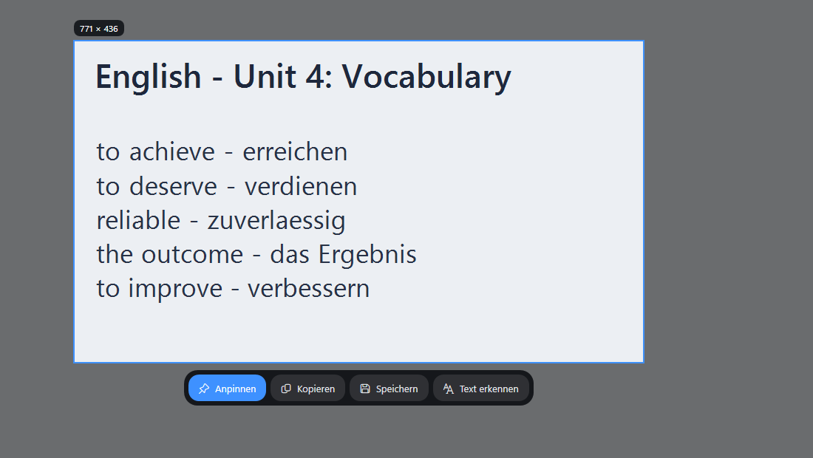
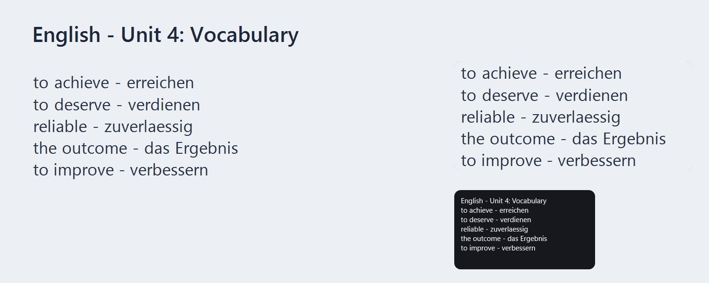

# Screenshot plugin for ue Bar

**English** · [Deutsch](README.de.md) · [back to ue Bar](../../README.md)

Capture an area, a window or a whole screen – then pin it next to your work, copy it, save it or
recognize its text. Text recognition is built into Windows and works offline; the images stay on
this PC. The plugin comes with ue Bar (plugin ID `screenshot`), is on by default and needs no setup.

## Taking a screenshot

- **Hotkey** `Win + Alt + S` (change it in the plugin's settings).
- **Tile** "Screenshot" (add it in edit mode, search "Screenshot"). As 2x1 it has buttons for area,
  window and screen.
- **Quick search / Assist:** `shot`, `shot window`, `shot screen`, `shot text` (in German also
  `shot fenster`, `shot bildschirm`). Mode and action can come in any order.

The screen freezes and darkens:

| Mode | How |
|---|---|
| **Area** (default) | Drag a rectangle – also across monitors, with any scaling. A click without dragging takes the window under the mouse. |
| **Window** | Click a window (the one under the mouse is framed). |
| **Screen** | The monitor under the mouse is taken right away; click another one to change. |

`Esc` or a right click cancels.

## After capturing

A small bar appears at the area: **Pin · Copy · Save ˅ · Recognize text** (`Enter` = Pin). In the
settings you can choose one of them as the default – then the bar is skipped.

- **Pin:** the screenshot becomes a [pin](../../README.md#pins) exactly where it was on the screen –
  zoom with the mouse wheel, move, keep it on top while you copy from it.
- **Copy:** to the clipboard (as image and PNG).
- **Save:** into `Pictures\Screenshots\ue Bar` (changeable), named `Screenshot 2026-11-20 14-03-05.png`;
  nothing is ever overwritten.
- **Save as …** (the small arrow next to "Save"): the Windows dialog – any folder, any name. It starts
  in the folder you picked last time (remembered on this PC).
- **Recognize text:** Windows reads the text (OCR) – copied to the clipboard, pinned as a text pin, or
  both (setting). The message offers the other one as a button.

The answer appears for a few seconds where the bar was – "233 characters recognized and copied · Pin",
"Screenshot saved" – also while Windows "Do not disturb" is on, because you just asked for it (**Settings
→ Notifications → Feedback**, on by default).

## Where is what?

- **The capture** exists only in memory. Copying and recognizing text write no file – not even a
  temporary one.
- **Save / Save as …** are the only ways a screenshot lands on the disk – in the screenshot folder or
  where you chose. The files stay there; ue Bar never deletes anything in that folder.
- **Pin:** the image lies in `%APPDATA%\ueBar\pins` while the pin is open and is deleted when you close
  the pin. Pinning never writes into the screenshot folder.

## Text recognition languages

Windows recognizes the languages whose "Optical character recognition" package is installed – usually
the display languages. **Automatic** uses your Windows languages; you can also pick one. If none is
installed, ue Bar says so and how to add one: **Windows settings → Time & language → Language & region
→ … next to the language → Language options → Optical character recognition**.

## Settings

| Setting | Default |
|---|---|
| Hotkey | `Win + Alt + S` (Delete = default, or "No hotkey") |
| Mode | Area |
| After capturing | Ask (the small bar) |
| Folder for saved screenshots | `Pictures\Screenshots\ue Bar` |
| Recognized text | Copy to the clipboard |
| Recognition language | Automatic |

## Privacy

Screenshots are never uploaded and never handed to other plugins. Saved files and pinned images are
on this PC only (pins under `%APPDATA%\ueBar\pins`, never in the synced layout).

## Module bus

Other plugins can use, with your permission (**Settings → Plugins → … → May use**):

| Kind | ID | Content |
|---|---|---|
| Action | `screenshot.capture` | `{ "mode"?: "region" \| "window" \| "screen", "action"?: "pin" \| "copy" \| "save" \| "saveas" \| "ocr" }` → `{ "started": true }` – the user still picks the area |
| Event | `screenshot.taken` | `{ "mode", "action", "width", "height", "monitors" }` – metadata only, never the image |

## How it works

The plugin only references the SDK. The overlay, the frozen screen and the small bar are the core's
**"pick a screen area"** (`IScreenAreaPicker`), pins come from the core's pin service – the plugin has no
UI code. Text recognition uses `Windows.Media.Ocr` (small images are enlarged first, which helps with
screen text).
