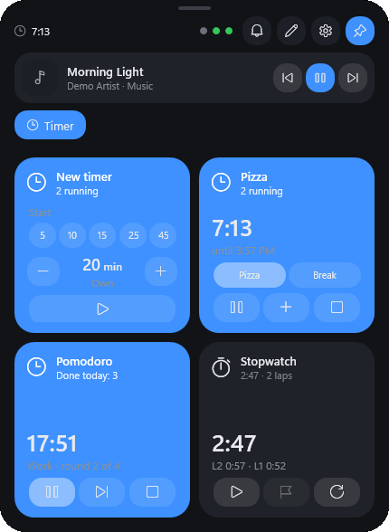
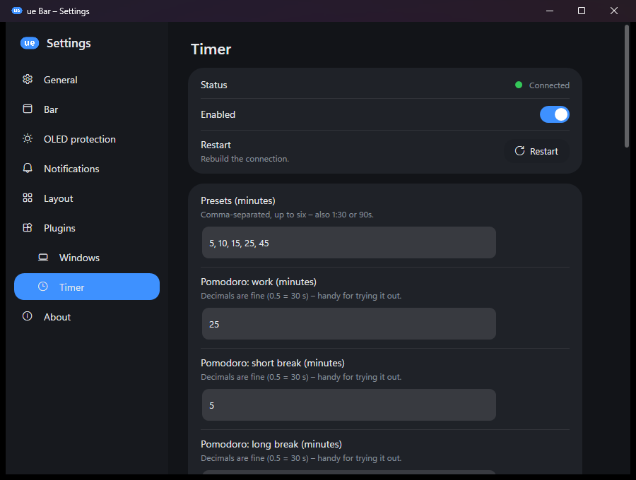
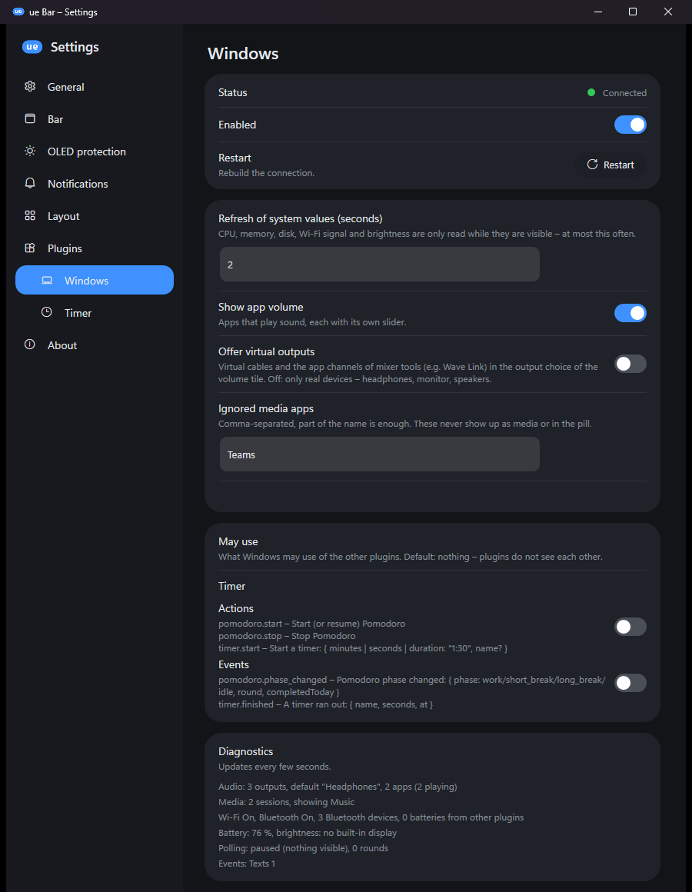

# Timer-Plugin für ue Bar

[English](README.md) · **Deutsch** · [zurück zu ue Bar](../../README.de.md)

Timer mit Voreinstellungen und Namen, eine Stoppuhr mit Runden und Pomodoro – in der Bar, in der
Schnellsuche (`t 10`) und in der Pill: Fährt die Bar aus, zeigt die Pill die Restzeit des nächsten
Timers. Eingeklappt ist nichts sichtbar (OLED). Das Plugin kommt mit der ue Bar (Plugin-ID
`timer`), ist standardmäßig an und braucht keine Einrichtung.

## Den Tab bekommen

Beim ersten Start bietet die ue Bar einen Tab **Timer** an. Bei einem bestehenden Layout:
**Einstellungen → Layout → Vorschlag eines Plugins hinzufügen → Timer**, oder einzelne Kacheln im
Bearbeiten-Modus (Suche nach „Timer“, „Stoppuhr“, „Pomodoro“).

## Kacheln

| Kachel | Zeigt / macht |
|---|---|
| Neuer Timer | Voreinstellungen (5/10/15/25/45 min – änderbar), eigene Dauer mit −/+, Start; Tippen = erste Voreinstellung |
| Laufende Timer | Zeit des gewählten Timers und wann er endet; bei mehreren Timern eine Auswahl; Pause/Fortsetzen (Tippen), +1 min, Stopp |
| Stoppuhr | Zeit, Start/Pause (Tippen), Runde, Zurücksetzen; die letzten Runden unter der Zeit |
| Pomodoro | Zeit der Phase, Phase und Runde, Start/Pause (Tippen), Überspringen, Beenden; „Heute erledigt“ |

Wert für die Statuszeile: **Nächster Timer** (Restzeit des Timers oder der Pomodoro-Phase, die
zuerst fällig ist).

## Schnellbefehle

In der Schnellsuche (Win+Alt+Leertaste) oder im Assist-Feld:

| Eingabe | Startet |
|---|---|
| `t 10` | einen 10-Minuten-Timer |
| `t 1:30` | 1 h 30 min |
| `t 90s`, `t 1h`, `t 2,5` | 90 Sekunden, 1 Stunde, 2,5 Minuten |
| `t 25 Lernen` | 25 Minuten mit dem Namen „Lernen“ |
| `pomo` / `pomo stop` | startet / beendet Pomodoro |

Wörter, die nur mit „t“ anfangen (z. B. „Toaster“), bleiben eine normale Suche.

## Wenn ein Timer abläuft

Eine Benachrichtigung fährt als Pill mit Ton aus und bleibt 60 s oder bis du sie schließt. Im
offenen Panel hat sie einen Knopf **+5 min** (startet denselben Timer noch einmal für 5 Minuten).
Einstellungen:

| Einstellung | Standard | Bedeutung |
|---|---|---|
| Ton | Windows-Alarm | Windows-Alarm, eigene Tondatei (.wav/.mp3) oder keiner |
| Lautstärke | 70 | nur für den Ton (0–100) |
| Auch bei „Nicht stören“ | an | die Meldung kommt auch, wenn „Nicht stören“ von Windows an ist |
| Auch im Vollbild | an | … und über Vollbild-Apps |

Pomodoro meldet jede Phase (Arbeiten, kurze Pause, lange Pause nach 4 Runden – alles änderbar;
Dezimalzahlen wie 0,5 = 30 s gehen, praktisch zum Ausprobieren).

## Neustart und Standby

Timer, Stoppuhr und Pomodoro werden mit ihren festen Endzeiten gespeichert. Beende die ue Bar mit
laufendem Timer und starte sie später: Er läuft weiter – oder, wenn er in der Zwischenzeit
abgelaufen ist, meldet die ue Bar das sofort („Abgelaufen um 14:32“). Genauso nach dem Standby.
Eine Pomodoro-Phase, die im Standby endete, startet die nächste Phase ab jetzt, statt verpasste
Phasen nachzuholen.

## Zusammenarbeit mit anderen Plugins (Modul-Bus)

Pomodoro kann beim Beginn einer Arbeitsphase oder Pause eine Aktion eines anderen Plugins
auslösen – zum Beispiel ein Home-Assistant-Skript, das das Licht dimmt. Plugins sehen sich
standardmäßig nicht; du gibst es pro Plugin frei:

1. **Einstellungen → Plugins → Timer → Darf nutzen:** die Aktionen des anderen Plugins einschalten.
2. Unter **Pomodoro: Aktion beim Arbeitsbeginn** (bzw. Pausenbeginn) die Aktion wählen und, falls
   sie welche braucht, ihre Argumente als JSON (die Beschreibung der Aktion sagt, was sie nimmt).
   Home Assistant zum Beispiel: Aktion `ha.call_service`, Argumente
   `{ "domain": "script", "service": "turn_on", "target": { "entity_id": "script.beispiel" } }`.

Schaltest du die Freigabe wieder aus, wird nichts mehr ausgelöst; der Timer fragt dann erneut nach
(ein Hinweis mit **Erlauben** unter Einstellungen → Plugins).

Das Plugin veröffentlicht selbst (andere dürfen sie nur mit Freigabe nutzen):

| Art | ID | Inhalt |
|---|---|---|
| Aktion | `timer.start` | `{ "minutes" \| "seconds" \| "duration": "1:30", "name"? }` → `{ "id" }` |
| Aktion | `pomodoro.start` / `pomodoro.stop` | Pomodoro starten (bzw. fortsetzen) / beenden |
| Ereignis | `timer.finished` | `{ name, seconds, at }` |
| Ereignis | `pomodoro.phase_changed` | `{ phase: work/short_break/long_break/idle, round, completedToday }` |

## Ressourcen

Eingeklappt tickt nichts: Das Plugin wacht nur auf, wenn etwas fällig ist. Die sekündliche
Aktualisierung der Anzeige läuft nur, solange die Pill, das Panel mit einer Timer-Kachel oder die
Statuszeile sichtbar ist.

## Für Entwickler

Alle Zeit läuft über `TimeProvider`; die Tests (`plugins/Timer/tests`) laufen mit einer Fake-Uhr –
über Mitternacht, Standby-Sprünge, Neustart mit laufenden und abgelaufenen Timern, der
Schnellbefehl-Parser, Freigaben erteilt/verweigert/widerrufen.
