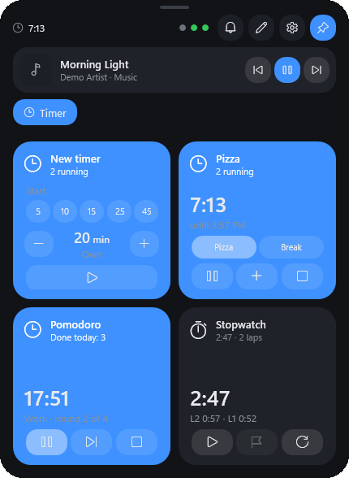
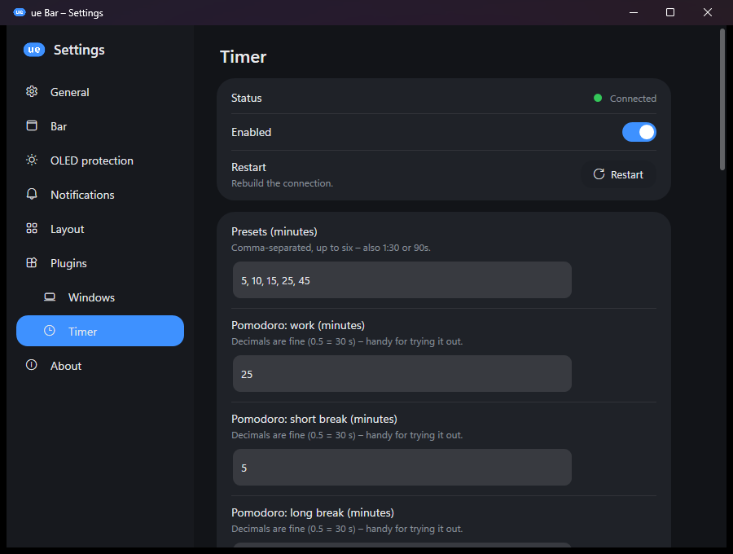
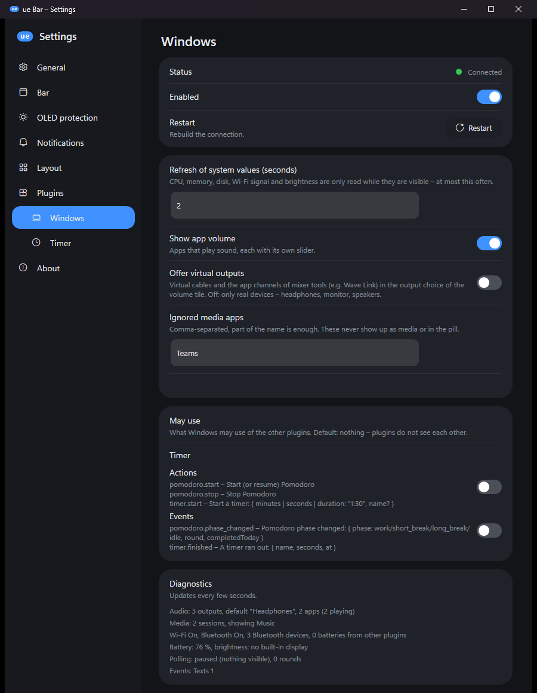

# Timer plugin for ue Bar

**English** · [Deutsch](README.de.md) · [back to ue Bar](../../README.md)

Timers with presets and names, a stopwatch with laps and Pomodoro – in the bar, in the quick
search (`t 10`) and in the pill: when the bar comes out, the pill shows the time left of the next
timer. Collapsed, nothing is visible (OLED). The plugin comes with ue Bar (plugin ID `timer`), is
on by default and needs no setup.

## Getting the tab

On the first start ue Bar offers a **Timer** tab. With an existing layout: **Settings → Layout →
Add a plugin's suggestion → Timer**, or add single tiles in the edit mode (search for "timer",
"stopwatch", "Pomodoro").

## Tiles

| Tile | Shows / does |
|---|---|
| New timer | presets (5/10/15/25/45 min – changeable), your own duration with −/+, start; tap = first preset |
| Running timers | time of the chosen timer and when it ends; with several timers a choice between them; pause/resume (tap), +1 min, stop |
| Stopwatch | time, start/pause (tap), lap, reset; the last laps below the time |
| Pomodoro | time of the phase, phase and round, start/pause (tap), skip, stop; "done today" |

Status line value: **next timer** (time left of the timer or Pomodoro phase due first).

## Quick commands

In the quick search (Win+Alt+Space) or the Assist field:

| Input | Starts |
|---|---|
| `t 10` | a 10-minute timer |
| `t 1:30` | 1 h 30 min |
| `t 90s`, `t 1h`, `t 2,5` | 90 seconds, 1 hour, 2.5 minutes |
| `t 25 Learning` | 25 minutes named "Learning" |
| `pomo` / `pomo stop` | starts / stops Pomodoro |

Words that merely start with "t" (like "toaster") stay a normal search.

## When a timer runs out

A notification comes out as a pill with a sound and stays for 60 s or until you close it. In the
open panel it has a **+5 min** button (starts the same timer again for 5 minutes). Settings:

| Setting | Default | Meaning |
|---|---|---|
| Sound | Windows alarm | Windows alarm, your own sound file (.wav/.mp3) or none |
| Volume | 70 | of the sound only (0–100) |

A timer that ran out is an **important** notification: by default it also comes out while the bar
is paused, during Windows "Do not disturb" and over fullscreen apps – switch that off for all
important notifications under **Settings → Notifications → Important notifications** (until 1.3.1
these were two switches of the timer; a switched-off value was taken over).

Pomodoro announces each phase (work, short break, long break after 4 rounds – all changeable;
decimals such as 0.5 = 30 s are fine for trying it out).

## Restart and standby

Timers, stopwatch and Pomodoro are saved with their absolute end times. Close ue Bar with a running
timer and start it later: it keeps running, or, if it ran out meanwhile, ue Bar reports it right
away ("ran out at 14:32"). The same after standby. A Pomodoro phase that ended while the PC slept
starts the next phase from now instead of catching up on phases nobody saw.

## Working with other plugins (module bus)

Pomodoro can run an action of another plugin when work or a break starts – for example a Home
Assistant script that dims the light. Plugins do not see each other by default; you allow it per
plugin:

1. **Settings → Plugins → Timer → May use:** switch on the actions of the other plugin.
2. Choose the action under **Pomodoro: action when work starts** (or break) and, if the action
   needs it, its arguments as JSON (the action's description says what it takes).
   Home Assistant, for example: action `ha.call_service`, arguments
   `{ "domain": "script", "service": "turn_on", "target": { "entity_id": "script.example" } }`.

Switch the permission off again and nothing is run any more; the timer then asks for it again (a
hint with **Allow** under Settings → Plugins).

The plugin publishes itself (others may use them only with permission):

| Kind | ID | Content |
|---|---|---|
| Action | `timer.start` | `{ "minutes" \| "seconds" \| "duration": "1:30", "name"? }` → `{ "id" }` |
| Action | `pomodoro.start` / `pomodoro.stop` | start (or resume) / stop Pomodoro |
| Event | `timer.finished` | `{ name, seconds, at }` |
| Event | `pomodoro.phase_changed` | `{ phase: work/short_break/long_break/idle, round, completedToday }` |

## Resources

Nothing ticks while the bar is collapsed: the plugin only wakes up when something is due. The
per-second update of the display runs only while the pill, the panel with a timer tile or the
status line is visible.

## For developers

All time goes through `TimeProvider`; the tests (`plugins/Timer/tests`) run with a fake clock –
over midnight, standby jumps, restarts with running and finished timers, the quick command parser,
permissions granted/denied/revoked.
