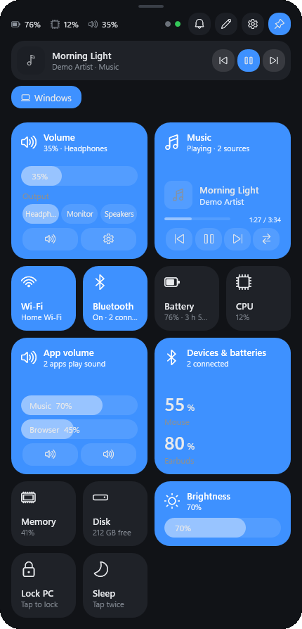
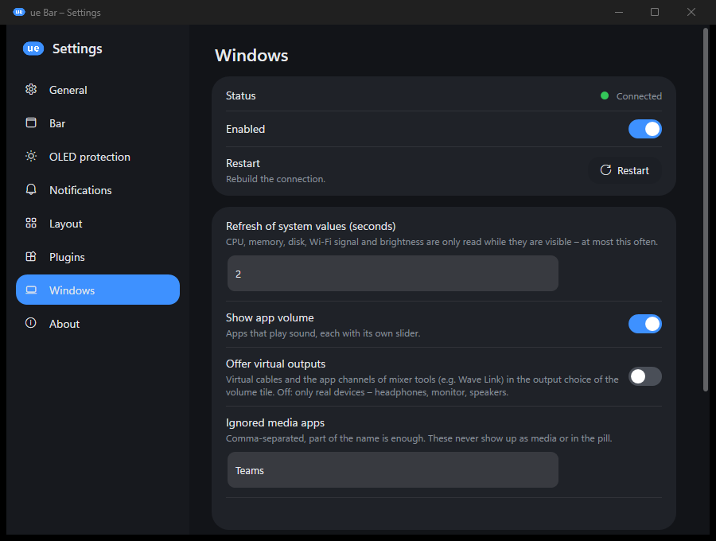

# Windows-Plugin für ue Bar

[English](README.md) · **Deutsch** · [zurück zu ue Bar](../../README.de.md)

Holt diesen PC in die ue Bar: Lautstärke und Ausgabegerät, die Lautstärke jeder App, alles, was
Windows als Wiedergabe kennt (Spotify, YouTube im Browser, andere Apps) – auch als Now Playing in
der Pill –, WLAN und Bluetooth, die Akkus deiner Bluetooth-Geräte, Akku, CPU, Arbeitsspeicher,
Datenträger, die Helligkeit des eingebauten Bildschirms sowie Sperren/Energiesparen/Bildschirm
aus. Das Plugin kommt mit der ue Bar (Plugin-ID `windows`), ist standardmäßig an und lässt sich
unter **Einstellungen → Plugins** ausschalten. Einrichten muss man nichts.

## Den Tab bekommen

Beim ersten Start bietet die ue Bar einen Tab **Windows** an (Lautstärke, Medien, WLAN,
Bluetooth, Akku, CPU, Arbeitsspeicher, Datenträger, Sperren). Hast du schon ein Layout, ändert
sich daran nichts von selbst – den Tab fügst du mit **Einstellungen → Layout → Vorschlag eines
Plugins hinzufügen → Windows** hinzu, oder einzelne Kacheln im Bearbeiten-Modus: Suche nach
„Lautstärke“, „Akku“, „WLAN“, einem App-Namen, einem Bluetooth-Gerät …

## Kacheln

| Kachel | Zeigt / macht |
|---|---|
| Lautstärke | Gesamtlautstärke, Stumm (Tippen), **Ausgabegerät** (Kopfhörer ↔ Monitor ↔ Lautsprecher), Knopf zu den Sound-Einstellungen |
| App-Lautstärke | die Apps, die gerade Ton haben, je mit Regler und Stumm-Knopf (bis zu 3 in einer 2x2-Kachel) |
| Lautstärke einer App | eine App: Tippen = stumm, Regler = Lautstärke |
| Medien | was Windows abspielt: Cover, Titel, Interpret, Fortschritt, Zurück/Play/Pause/Weiter; bei mehreren Quellen wechselt ein Knopf zwischen ihnen |
| WLAN | an/aus (Tippen), verbundenes Netz und Signal |
| Bluetooth | an/aus (Tippen), Zahl der verbundenen Geräte, Knopf zu den Bluetooth-Einstellungen |
| Geräte & Akkus | verbundene Bluetooth-Geräte mit Akkustand, der niedrigste zuerst |
| Bluetooth-Gerät | ein Gerät: Akku und verbunden/getrennt |
| Systemwert | Akku (mit Restzeit / Zeit bis voll), CPU, Arbeitsspeicher, freier Speicherplatz |
| Helligkeit | Helligkeit des eingebauten Laptop-Bildschirms – nur wenn er an ist |
| Aktion | PC sperren, Energiesparen (innerhalb von 5 s zweimal tippen), Bildschirm aus |

Werte für die Statuszeile: Akku, CPU, Arbeitsspeicher, Datenträger, Lautstärke, Medien.

## Ausgabegerät

Für Programme gibt es keinen offiziellen Weg, das Standard-Ausgabegerät zu wechseln. Das Plugin
nutzt dieselbe Schnittstelle wie die Sound-Einstellungen von Windows (`IPolicyConfig`). Klappt das
einmal nicht, sagt es die Kachel, und der Knopf daneben öffnet die Sound-Einstellungen.

Die Auswahl auf der Kachel zeigt nur echte Geräte (höchstens vier). Virtuelle Kabel und die
App-Kanäle von Mixer-Programmen wie Elgato Wave Link bleiben weg, außer du schaltest **Virtuelle
Ausgaben anbieten** ein; ein gerade aktives virtuelles Gerät wird immer gezeigt.

## Medien und Now Playing

Das Plugin sieht jede App, die sich bei der Mediensteuerung von Windows meldet (das Medienfenster
neben der Lautstärke) – Spotify, Browser mit YouTube oder anderen Playern, Windows Media Player …
Gezeigt wird die, die spielt; spielen mehrere, die, die Windows selbst für aktuell hält. Bei
mehreren Quellen wechselt ein Knopf auf der Medien-Kachel; deine Wahl bleibt, bis die App
geschlossen wird. Apps auf der Liste **Ignorierte Medien-Apps** (Standard: Teams) erscheinen nie.

Melden mehrere Plugins eine Wiedergabe (z. B. Windows und ein Medienplayer aus Home Assistant),
entscheidet **Einstellungen → Bar → Now Playing: Reihenfolge der Quellen**. Standard: Wiedergabe
auf diesem PC zuerst. Was gerade spielt, kommt immer vor Pausiertem.

## Bluetooth-Geräte und Akkus

Der Akkustand ist der, den Windows unter **Einstellungen → Bluetooth & Geräte** zeigt – Headsets,
Earbuds, Mäuse, Tastaturen, Handys, soweit das Gerät ihn meldet. Geräte an einem eigenen
Funk-Empfänger des Herstellers (2,4-GHz-Gaming-Mäuse, Headsets mit eigenem Dongle) melden sich
nicht bei Windows; ihren Stand kennt nur die Hersteller-Software. Solche Hersteller-Plugins können
Akkus an die ue Bar melden (`IDeviceBatterySource`); die Kachel „Geräte & Akkus“ zeigt sie
zusammen mit den Bluetooth-Geräten.

Geräte verbinden oder koppeln gehört nicht zum Plugin – die Bluetooth-Kachel öffnet dafür die
Windows-Einstellungen.

## Ressourcen

- Lautstärke, Apps, Medien, WLAN/Bluetooth an/aus und der Akku kommen **per Ereignis** – dafür wird
  nichts abgefragt.
- CPU, Arbeitsspeicher, Datenträger, WLAN-Signal und Helligkeit werden nur gelesen, **solange sie
  sichtbar sind** (Panel offen auf ihrem Tab oder in der Statuszeile), höchstens alle 2 s
  (Einstellung); WLAN-Signal und Helligkeit höchstens alle 10 s, Bluetooth-Geräte und ihre Akkus
  höchstens alle 30 s. Eingeklappt wird nichts gelesen.
- Positionsänderungen der Player (die kommen oft) werden nur gelesen, solange eine Medien-Kachel
  sichtbar ist.

## Einstellungen

| Einstellung | Standard | Bedeutung |
|---|---|---|
| Takt der Systemwerte | 2 s | wie oft sichtbare CPU-/Speicher-/Datenträger-Werte gelesen werden (2–60 s) |
| App-Lautstärke anzeigen | an | die Kachel „App-Lautstärke“ und App-Namen in der Suche |
| Virtuelle Ausgaben anbieten | aus | virtuelle Geräte in der Ausgabe-Auswahl |
| Ignorierte Medien-Apps | Teams | durch Komma getrennt, ein Teil des Namens reicht |

## Modul-Bus

Das Plugin veröffentlicht (andere Plugins dürfen sie nur mit Freigabe nutzen):

| Art | ID | Inhalt |
|---|---|---|
| Aktion | `win.set_volume` | `{ "volume": 0–100 }` |
| Aktion | `win.mute` | `{ "muted": true/false }`, ohne Argumente: umschalten |
| Aktion | `win.media_play_pause` | aktuelle Wiedergabe abspielen/pausieren |
| Aktion | `win.lock` | PC sperren |
| Wert | `win.battery` | `{ percent, charging, onAc }`, `null` ohne Akku |
| Wert | `win.cpu` | CPU in Prozent (aktualisiert, solange sie angezeigt wird) |
| Wert | `win.audio_device` | `{ id, name }` des Standard-Ausgabegeräts |
| Ereignis | `win.media_changed` | `{ app, title, artist, playing }` |

## Hinweise

- **WLAN-Name:** Seit Windows 11 24H2 brauchen Apps dafür die Standortberechtigung. Ohne sie zeigt
  die Kachel „Verbunden“ statt des Namens.
- **Energiesparen auf Laptops mit Modern Standby:** Windows lässt Programme diese Art Standby nicht
  starten. Das Plugin schaltet stattdessen den Bildschirm aus – Windows geht dann selbst in den
  Standby.
- **Eingebauter Bildschirm:** Die Helligkeit geht nur für das Display des Laptops (für externe
  Monitore bietet Windows sie so nicht an); bei zugeklapptem Laptop sagt die Kachel das.

## Für Entwickler

`UEBAR_WINDOWS_DEMO=1` ersetzt diesen PC durch Demo-Daten (neutrale Gerätenamen) – so sind die
Bilder oben entstanden. Zusammen mit `UEBAR_DATA_DIR` läuft eine zweite ue Bar mit eigenen Daten
neben der normalen.

Tests: `plugins/Windows/tests` – die Logik läuft gegen Fakes der Windows-Schnittstellen (Audio,
Medien, Funk, Bluetooth, System), dazu ein Test, der den echten Plugin-Ordner über den normalen
Plugin-Lader lädt.
