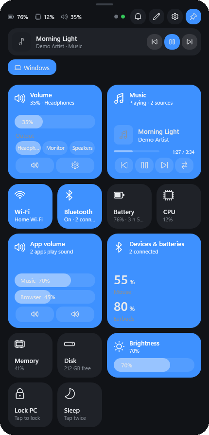
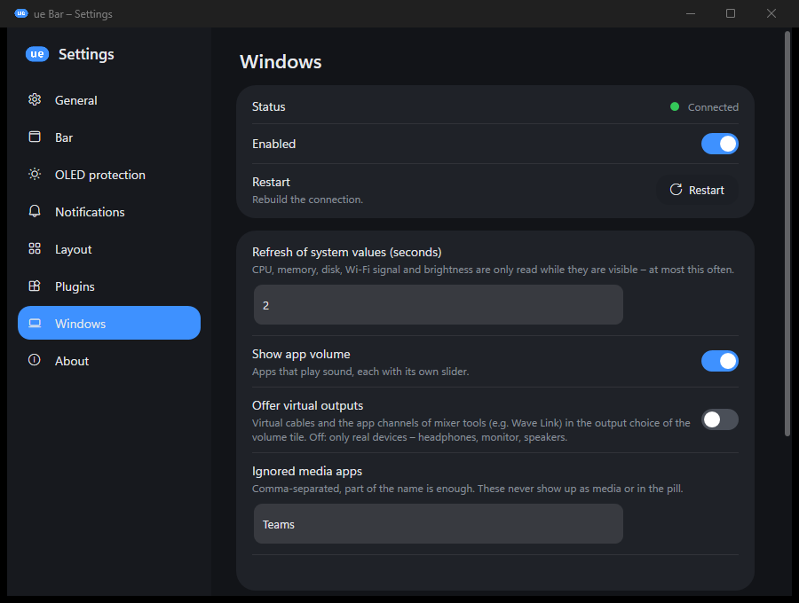

# Windows plugin for ue Bar

**English** · [Deutsch](README.de.md) · [back to ue Bar](../../README.md)

Brings this PC into ue Bar: volume and output device, the volume of each app, everything Windows
knows as media (Spotify, YouTube in the browser, other apps) – also as Now Playing in the pill –,
Wi-Fi and Bluetooth, the batteries of your Bluetooth devices, battery, CPU, memory, disk, the
brightness of the built-in display, and lock/sleep/screen off. The plugin comes with ue Bar
(plugin ID `windows`), is on by default and can be switched off under **Settings → Plugins**.
It needs no setup.

## Getting the tab

On the first start ue Bar offers a **Windows** tab (volume, media, Wi-Fi, Bluetooth, battery,
CPU, memory, disk, lock). If you already have a layout, nothing changes by itself – add the tab
with **Settings → Layout → Add a plugin's suggestion → Windows**, or add single tiles in the edit
mode: search for "volume", "battery", "Wi-Fi", an app name, a Bluetooth device …

## Tiles

| Tile | Shows / does |
|---|---|
| Volume | master volume, mute (tap), **output device** (headphones ↔ monitor ↔ speakers), button to the sound settings |
| App volume | the apps that play sound right now, each with a slider and a mute button (up to 3 in a 2x2 tile) |
| Volume of an app | one app: tap = mute, slider = volume |
| Media | what Windows plays: cover, title, artist, progress, previous/play/pause/next; with several sources a button switches between them |
| Wi-Fi | on/off (tap), connected network and signal |
| Bluetooth | on/off (tap), number of connected devices, button to the Bluetooth settings |
| Devices & batteries | connected Bluetooth devices with their battery level, lowest first |
| Bluetooth device | one device: battery and connected/disconnected |
| System value | battery (with time left / until full), CPU, memory, free disk space |
| Brightness | brightness of the built-in laptop display – only when it is on |
| Action | lock the PC, sleep (tap twice within 5 s), screen off |

Status line values: battery, CPU, memory, disk, volume, media.

## Output device

Windows has no official way for programs to change the default output. The plugin uses the same
interface Windows' own sound settings use (`IPolicyConfig`). If that ever fails, the tile says so
and the button next to it opens the sound settings.

The choice on the tile shows real devices only (at most four). Virtual cables and the app channels
of mixer tools such as Elgato Wave Link are left out unless you switch on **Offer virtual
outputs**; an active virtual device is always shown.

## Media and Now Playing

The plugin sees every app that reports to Windows' media controls (the media flyout next to the
volume) – Spotify, browsers with YouTube or other players, Windows Media Player … It shows the one
that plays; if several play, the one Windows itself considers current. With several sources a
button on the media tile switches; your choice stays until that app closes. Apps on the
**Ignored media apps** list (default: Teams) never show up.

If more than one plugin reports playback (for example Windows and a Home Assistant media player),
**Settings → Bar → Now Playing: order of the sources** decides. Default: playback on this PC
first. What plays always comes before what is paused.

## Bluetooth devices and batteries

The battery level is the one Windows shows under **Settings → Bluetooth & devices** – headsets,
earbuds, mice, keyboards, phones, as far as the device reports it. Devices on a vendor's own
wireless dongle (2.4 GHz gaming mice, headsets with their own receiver) do not report to Windows;
their level only the vendor software knows. Such vendor plugins can report batteries to ue Bar
(`IDeviceBatterySource`); the Devices tile shows them together with the Bluetooth devices.

Connecting or pairing devices is not part of the plugin – the Bluetooth tile opens the Windows
settings for that.

## Resources

- Volume, apps, media, Wi-Fi/Bluetooth on/off and the battery are **event driven** – nothing is
  polled for them.
- CPU, memory, disk, Wi-Fi signal and brightness are only read **while they are visible** (panel
  open on their tab, or in the status line), at most every 2 s (setting); Wi-Fi signal and
  brightness at most every 10 s, Bluetooth devices and their batteries at most every 30 s.
  Collapsed, nothing is read.
- Position updates of players (they come often) are only read while a media tile is visible.

## Settings

| Setting | Default | Meaning |
|---|---|---|
| Refresh of system values | 2 s | how often visible CPU/memory/disk values are read (2–60 s) |
| Show app volume | on | the App volume tile and app names in the search |
| Offer virtual outputs | off | virtual devices in the output choice |
| Ignored media apps | Teams | comma-separated, part of the name is enough |

## Module bus

The plugin publishes (other plugins may use them only with permission):

| Kind | ID | Content |
|---|---|---|
| Action | `win.set_volume` | `{ "volume": 0–100 }` |
| Action | `win.mute` | `{ "muted": true/false }`, without arguments: toggle |
| Action | `win.media_play_pause` | play/pause the current media |
| Action | `win.lock` | lock the PC |
| Value | `win.battery` | `{ percent, charging, onAc }`, `null` without battery |
| Value | `win.cpu` | CPU in percent (updated while it is shown) |
| Value | `win.audio_device` | `{ id, name }` of the default output |
| Event | `win.media_changed` | `{ app, title, artist, playing }` |

## Notes

- **Wi-Fi network name:** since Windows 11 24H2 apps need the location permission for it. Without
  it the tile shows "Connected" instead of the name.
- **Sleep on laptops with Modern Standby:** Windows does not let programs start this kind of
  standby. The plugin switches the screen off instead – Windows then goes into standby by itself.
- **Built-in display:** brightness only works for the laptop's own panel (Windows does not offer
  it for external monitors this way); with the lid closed the tile says so.

## For developers

`UEBAR_WINDOWS_DEMO=1` replaces this PC with demo data (neutral device names) – that is how the
pictures above were made. Together with `UEBAR_DATA_DIR` a second ue Bar with its own data runs
next to the normal one.

Tests: `plugins/Windows/tests` – the logic runs against fakes of the Windows interfaces (audio,
media, radios, Bluetooth, system), plus a test that loads the real plugin folder through the
normal plugin loader.
